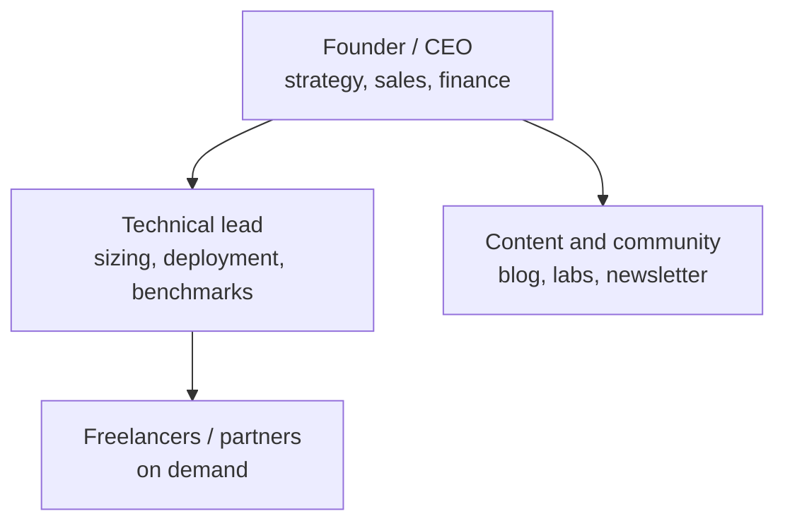
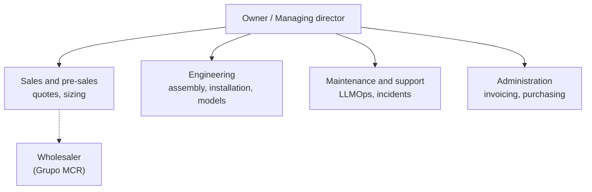
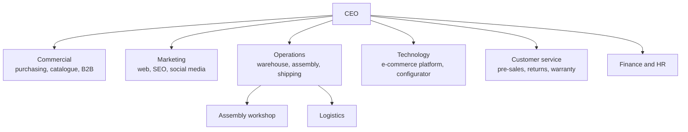
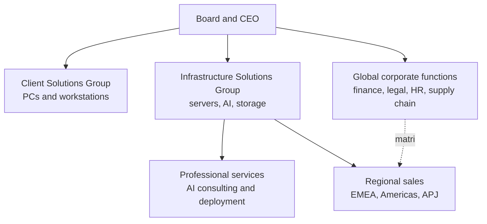
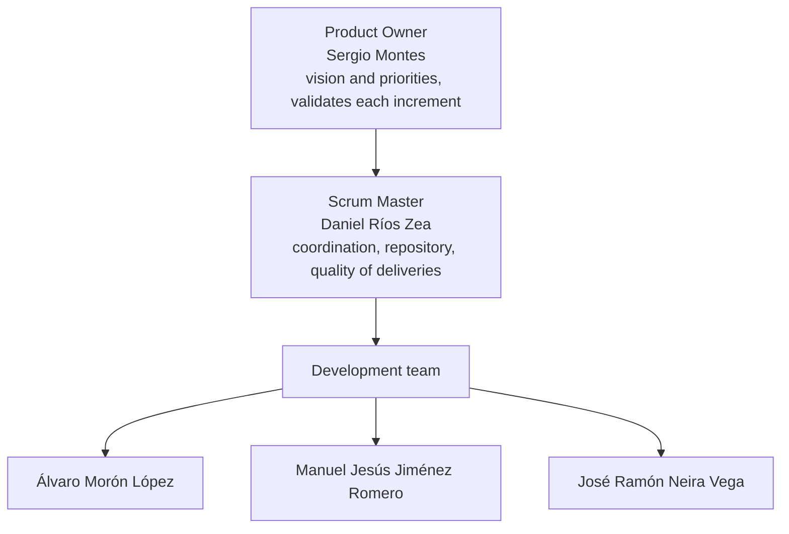

# Sector Analysis: Local AI Hardware for Businesses

> **Task 1 – Initial sector exploration.** Team DAMN · Proyecto Intermodular 2º DAW · ILERNA Sevilla · October 2026
> Startup (working name): **Intramuros** – *your AI, inside your walls*.
> The investor pitch (in Spanish) is linked from the [README](../../README.md).

## Contents

1. [Sector introduction](#1-sector-introduction)
2. [Companies analysed](#2-companies-analysed)
3. [Organisational structures](#3-organisational-structures)
4. [Main departments and their functions](#4-main-departments-and-their-functions)
5. [Customer needs and business volume](#5-customer-needs-and-business-volume)
6. [Trends and opportunities](#6-trends-and-opportunities)
7. [Initial conclusions](#7-initial-conclusions)
8. [Our startup's organisational chart](#8-our-startups-organisational-chart)
9. [Sources](#9-sources)

---

## 1. Sector introduction

The sector sells **computers built to run AI models on the customer's own premises** ("local" or "on-premise" AI), instead of sending data to a cloud service. It sits where two older businesses meet:

- **PC component e-commerce and custom PC assembly** (PcComponentes, Coolmod): the customer picks parts online and the shop builds and ships the machine.
- **IT system integration**: the provider installs, configures and maintains infrastructure on the customer's site.

What is new is the **software layer**: the machine arrives with open models (Llama, Qwen, Gemma, Mistral…) installed and, increasingly, adapted to the customer's documents and processes.

Why now:

- **Adoption is growing fast.** In Q1 2025, 21.1% of Spanish companies with 10+ employees used AI, 8.7 points more than a year earlier (INE).
- **Companies want their data at home.** In a February 2026 survey of 203 enterprise IT decision-makers, 91% would choose on-premises, private cloud or hybrid over public cloud for AI on sensitive data (Cloudian).
- **Big players are moving in.** On 13 October 2026, PcComponentes' CEO confirmed it will sell "from workstations to servers to run models locally" to businesses (Xataka).

## 2. Companies analysed

We picked five real companies that cover every size and every way of reaching the customer: a consultancy-style startup, a small integrator ("agency" model), a medium and a large online retailer, and a multinational manufacturer with its own consulting arm.

Size bands follow the EU definition: micro < 10 employees, small < 50, medium < 250, large ≥ 250.

| Company | Size | Location | What it sells | Customers | Size data |
| --- | --- | --- | --- | --- | --- |
| [VORLUX AI](https://vorluxai.com/) | Micro (startup) | Valencia | Advice, sizing and deployment of local AI; hardware recommendations; developer tools; AI Act / GDPR checklists; training | Developers, European SMEs and public bodies worried about data sovereignty | Run by J4SGON S.L.; headcount not public |
| [AIHARD](https://www.aihard.es/) | Micro / small (integrator) | Castelldefels (Barcelona) | AI mini PCs, AI workstations, SME AI servers, racks/CPD; model and agent installation; LLMOps maintenance; training | Freelancers, small offices, SMEs, industrial sites (AI cameras) | Brand of Vanguard LB Consulting S.L.U.; headcount not public |
| [Coolmod](https://valenciaplaza.com/valenciaplaza/empresas1/coolmod-los-lideres-en-montaje-de-ordenadores-a-la-carta-que-deslumbran-a-nvidia-desde-castellon) | Medium | Almassora (Castellón) | Online high-end hardware store; custom-built PCs (90–100 per day) | Gamers and professionals (design, data, AI), universities, research centres, tech companies | 65 staff (≈85 at peaks); €38–40 M revenue expected in 2025 |
| [PcComponentes](https://www.xataka.com/robotica-e-ia/uno-mayores-distribuidores-hardware-espana-ha-tenido-idea-para-seguir-creciendo-convertirse-dell) | Large | Alhama de Murcia | Tech e-commerce with PC configurator and marketplace; from Oct 2026, local AI workstations and servers for businesses | Consumers and businesses in Spain, France, Germany, Italy and Portugal | €825 M sales in 2025 (+13%); 550+ staff (2020, last public figure) |
| [Dell Technologies](https://www.tikr.com/blog/dell-closes-fy2026-with-record-113b-revenue-why-analysts-see-a-171-price) | Large (multinational) | Round Rock (Texas, USA) | PCs, workstations, AI servers ("AI Factory") and professional services | Large companies, governments, cloud providers | $113 B revenue in FY2026; $25.2 B in AI server shipments; ≈97,000 employees |

### Company profiles

**VORLUX AI – the consultancy-style startup.**
It sells knowledge more than boxes: it recommends hardware by task, publishes its own benchmarks (for example, Gemma 4 26B at 60.7 tokens/s on a DGX Spark) and offers sizing, deployment on the client's network, compliance checklists and training. It publishes reference hardware prices (Beelink SER8 ≈ €550 for 7–8B models; Mac Mini M4 Pro 48 GB ≈ €1,840 for 32B; Jetson AGX Thor 128 GB ≈ €3,499 for 70B), but no service prices: the first contact is a free 15-minute call.

**AIHARD – the small integrator.**
It is closest to what we want to be: it sells the machine **and** installs models and agents on it (Ollama, RAG, MCP), then maintains them (monitoring, model updates, re-indexing documents). Its entry product is a mini PC for 1–3 people from **€1,167.99** (VAT included). Servers for SMEs (two 16 GB GPUs) are quoted case by case. On-site service is limited to the Barcelona area; elsewhere it works remotely.

**Coolmod – the medium specialist retailer.**
Founded in 2002, it builds custom PCs and is one of the three companies that sell the most graphics cards in Spain, according to Nvidia. It has about 500,000 customers and an average ticket close to €900. It does **not** offer maintenance: it refers customers to local installers. It targets €100 M revenue by 2028 and expansion to France, Germany and Italy.

**PcComponentes – the large national retailer.**
Founded in 2005 with €3,000 of share capital, it now runs a 40,000 m² logistics centre and has sold custom-built PCs since its first year. In October 2026 it announced local AI systems for businesses, with advice on which machine fits each need. It is the strongest future competitor in Spain.

**Dell Technologies – the multinational.**
It started in 1984 selling PCs and became a large AI server supplier. In FY2026 it closed $64.1 B in AI orders and ended the year with a $43 B AI backlog. It combines manufacturing, global sales and a consulting arm that designs and deploys AI infrastructure for large customers.

## 3. Organisational structures

The five companies show four structural models. As a company grows, it moves from people who do everything to departments, then to business divisions, and finally to a matrix.

### 3.1 Startup (VORLUX AI type): flat structure

Two or three people cover every function. The founder sells, decides and often delivers the project. Decisions are immediate, but the company depends on very few people and cannot take many projects at once.

### 3.2 Small integrator ("agency" model, AIHARD type): structure by service

Organised around **what it delivers to the client** (sell → build → install → maintain), like a service agency. Each project goes through every area. The owner still supervises every quote. Partners (a wholesaler, other consultancies) replace departments it cannot afford.

### 3.3 Medium and large e-commerce (Coolmod and PcComponentes type): functional structure

One department per **function**, each with its own manager. Specialisation is high and processes are standardised (Coolmod builds 90–100 PCs a day). PcComponentes adds layers on top: country teams for its five markets, a marketplace and a tech office in Granada. Coordination between departments becomes the main challenge.

### 3.4 Multinational (Dell Technologies type): divisional and matrix structure

Divided by **business line** (PCs vs infrastructure) and by **region**. A salesperson in Spain reports both to the regional manager and to the product division (matrix). It can deliver projects in any country, but decisions are slow and a small client is not a priority.

### 3.5 Comparison

| Aspect | Startup | Small integrator (agency) | Medium / large e-commerce | Multinational (consultancy arm) |
| --- | --- | --- | --- | --- |
| Model | Flat | By service | Functional | Divisional + matrix |
| Hierarchy levels | 1–2 | 2 | 3–4 | 5+ |
| Who decides | Founder, at once | Owner, per project | Department heads, by process | Committees, by division and region |
| Specialisation | Low: everyone does everything | Medium | High | Very high |
| Speed with a new client | Very high | High | Medium: standard catalogue | Low for small clients |
| Main risk | Depends on 2–3 people | Owner as bottleneck | Silos between departments | Bureaucracy, high cost |
| Typical customer | Early adopters | Local SMEs | Consumers and SMEs nationwide | Large companies and governments |

## 4. Main departments and their functions

These are the departments found across the sector. The last column shows how the business would suffer without each one.

| Department | Main functions | How it contributes to the business | Present in |
| --- | --- | --- | --- |
| **Management** | Strategy, investment, partnerships with manufacturers (Nvidia, AMD), pricing policy | Sets which customers to target and secures supply and margins; Coolmod's Nvidia ties give it stock others lack | All |
| **Sales and pre-sales (B2B)** | Detect needs, size the machine for the client's use case, prepare quotes, close deals | Turns a vague need ("AI for our documents") into a concrete order; in this sector, pre-sales advice is the product | All; a separate team from medium size up |
| **Purchasing and supply chain** | Buy GPUs, memory and components; negotiate with wholesalers; manage stock | With GPU and memory prices rising sharply, buying well decides the margin and the delivery time | Medium, large |
| **Operations: assembly and quality** | Build the machine, burn-in tests, install the OS and drivers, quality control | Guarantees each machine works on arrival; returns on €5,000–€20,000 machines are very costly | All (outsourced in a startup) |
| **Logistics** | Warehouse, packing, shipping, returns | Fast, safe delivery of fragile, high-value equipment; PcComponentes built a 40,000 m² centre for this | Medium, large |
| **AI engineering** | Install and tune models, set up RAG over company documents, agents, fine-tuning, benchmarks | The difference from a component shop: the client buys a working solution, not a box | Startups and integrators; new in large retailers |
| **Technical support and maintenance (LLMOps)** | Incidents, model updates, security patches, monitoring, warranty | Creates recurring revenue and long-term relationships; Coolmod does not offer it, which is a gap | Integrators, multinationals |
| **Technology / web development** | E-commerce platform, product configurator, internal systems (ERP, CRM) | The configurator is the shop window and the sales engine of an online business | Medium, large |
| **Marketing** | Brand, SEO, content, social media, trade fairs, newsletters | Educates a market that still does not know local AI exists; VORLUX and AIHARD use blogs and free training to attract leads | All |
| **Administration, finance and legal** | Invoicing, accounting, financing, contracts, GDPR and AI Act compliance | Keeps cash flow healthy with expensive stock and supports clients with their legal obligations | All; outsourced in small companies |
| **Human resources** | Hiring, training, internships, culture | Technical talent is scarce; Coolmod hires 12–14 interns a year and 60–70% of its staff started as students | Medium, large |

## 5. Customer needs and business volume

### 5.1 Who the customers are

Spain had **3,310,824 active companies** on 1 January 2025 (INE, DIRCE):

- 1,348,909 with 1–9 employees
- 85,467 with 10–19
- 76,005 with 20 or more

| Segment | Typical need | Solution | Price range |
| --- | --- | --- | --- |
| **Freelancers and micro offices** (1–3 users): lawyers, accountants, clinics | Private assistant to draft, summarise and search documents without uploading client data | "AI workstation" mini PC with a 7–32B model | **€550–€1,840** for the hardware (VORLUX references); AIHARD's AI mini PC from **€1,167.99** VAT incl. |
| **Small companies** (5–20 users) | Shared assistant over the company's documents (RAG), transcription, customer service drafts | 128 GB "department" machine (DGX Spark class, Jetson AGX Thor) with a 70B model | **€3,499** (Jetson AGX Thor) to **€5,038–€8,096** net (DGX Spark models) |
| **Medium companies** (20–100 users) | Several departments at once, agents connected to ERP/CRM, models adapted to the business | Workstation with 1–2 RTX PRO 6000 (96 GB each) | **≈ €22,000–€45,000** (own estimate: €17,003 per GPU in October 2026 plus platform) |
| **Large companies and public bodies** | Many concurrent users, training and fine-tuning, high availability | Multi-GPU rack servers and installation in the data centre (CPD) | **€80,000+** per server (own estimate); Dell-type projects worth millions |

Services add recurring revenue on top of the hardware:

- **Installation and set-up** of models.
- **Customisation** with RAG over the client's documents, or fine-tuning.
- **Maintenance subscriptions** (LLMOps).

AIHARD and VORLUX quote these case by case. We will estimate our own prices in a later task.

### 5.2 Concrete project examples

1. **Law firm with 3 lawyers.** Needs to summarise case files without breaching professional secrecy. Mini PC with a 14–32B model and RAG over its files: about €1,200–€1,900 of hardware plus installation.
2. **Engineering SME with 50 employees.** The use case PcComponentes itself cites: private RAG for 50 employees.
   - Alternative in the cloud: Microsoft 365 Copilot Business costs $18 per user per month (annual commitment). That is $10,800 a year for 50 users, or $18,000 at the Enterprise price ($30).
   - Our alternative: a DGX Spark-class machine (€5,000–€8,000) is a one-off cost in the same range as one year of subscriptions, and the data never leaves the office.
3. **Hospital or public body.** Many users, sensitive health data, strict compliance. Multi-GPU server in its own CPD, plus maintenance contract. This is where Dell competes.

### 5.3 Size of the opportunity

- **The sector is large and growing.** PcComponentes sold €825 M in 2025 and Coolmod expects €38–40 M. Both now see business demand for local AI: PcComponentes reports "a significant rise" in companies buying hardware for local AI projects.
- **Adoption is still low.** Only about one in five companies with 10+ employees used AI in Q1 2025, so most of the market has not bought yet.
- **Illustrative scenario (own estimate).** There are 161,472 companies with 10 or more employees. If **1%** bought one department machine at €6,000 in a year, the market would be **≈ €9.7 M per year in hardware alone**, before services. A small startup that won 2% of that scenario would invoice around €190,000 a year.

## 6. Trends and opportunities

| Trend | What is happening | Opportunity or risk for us |
| --- | --- | --- |
| **Data sovereignty** | 91% of IT decision-makers prefer on-premises, private or hybrid for AI with sensitive data; 58% say data residency concerns have delayed or reduced AI projects (Cloudian, 2026) | **Opportunity**: our core message. The client keeps its data inside its walls |
| **Regulation (AI Act + GDPR)** | AI Act transparency duties apply from 2 August 2026; high-risk duties were postponed to 2 December 2027 (Annex III) and 2 August 2028 (Annex I); AI literacy has applied since February 2025 | **Opportunity**: sell compliance help and training with the machine. Uncertainty slows some buyers |
| **Better open models on smaller machines** | 70B-class models run on 128 GB unified-memory desktops (DGX Spark, Ryzen AI Max+ 395, Jetson Thor) | **Opportunity**: department-level machines cost thousands, not tens of thousands |
| **GPU and memory prices rising** | Memory and storage costs rose 40–70% during 2025 (Omdia); average RTX 5090 price in Spain above €6,200 (Aug 2026); RTX PRO 6000 from €7,628 to €17,003 in 12 months | **Risk**: margins and stock. **Opportunity**: clients need expert advice to buy the right size and not overspend |
| **Big retailers entering** | PcComponentes announced local AI for businesses in October 2026 | **Risk**: price competition. **Validation**: the market is real. Our space: personalised service, model customisation and maintenance |
| **Skills gap** | Lack of skills is the first reason medium and large EU companies give for not using AI (Eurostat 2025, via Euronews); privacy and legal uncertainty follow | **Opportunity**: deliver the solution ready to use, with training |

## 7. Initial conclusions

1. **There is a gap between the shop and the consultancy.** Retailers (Coolmod, PcComponentes) sell excellent hardware but little service; integrators (AIHARD, VORLUX) offer service but are local or small. A company that combines an **online configurator by use case** with **pre-installed, customised models and maintenance** has room to grow.
2. **The target is the SME.** Freelancers and companies with 3–100 employees need privacy, cannot hire AI engineers and are ignored by multinationals. There are more than 1.5 million companies with employees in Spain.
3. **Our business must be solutions, not components.** With volatile GPU prices, pure hardware margins are fragile. Recurring revenue (installation, customisation, maintenance) makes the business stable.
4. **The structure must start flat and grow by function.** We start like a startup and should evolve to a functional structure (pre-sales, engineering, operations, support) as volume grows, avoiding the silos of large companies.
5. **Next steps:** define the MVP of the configurator web platform, the product catalogue by tier and our service pricing.

## 8. Our startup's organisational chart

Intramuros keeps the same structure as the project team:

Technical areas (frontend, backend, database, integrations, design and deployment) are assigned at each Sprint Planning, and every member works across all of them during the project. See [docs/team/README.md](../team/README.md).

## 9. Sources

All accessed in October 2026.

- [VORLUX AI – website](https://vorluxai.com/)
- [AIHARD – website](https://www.aihard.es/) and [services](https://www.aihard.es/es/servicios)
- [Valencia Plaza – Coolmod, los líderes en montaje de ordenadores a la carta… (24/11/2025)](https://valenciaplaza.com/valenciaplaza/empresas1/coolmod-los-lideres-en-montaje-de-ordenadores-a-la-carta-que-deslumbran-a-nvidia-desde-castellon)
- [Xataka – PcComponentes and local AI (13/10/2026)](https://www.xataka.com/robotica-e-ia/uno-mayores-distribuidores-hardware-espana-ha-tenido-idea-para-seguir-creciendo-convertirse-dell)
- [Murcia Plaza – PcComponentes: €730 M in 2024 (10/10/2025)](https://murciaplaza.com/murciaplaza/empresas-murcia/pccomponentes-espera-elevar-sus-ventas-un-15-este-2025-tras-alcanzar-una-facturacion-de-730-millones)
- [PcComponentes – Our history](https://www.pccomponentes.com/quienes-somos-historia)
- [Hispanopedia – PcComponentes](https://es.hispanopedia.com/wiki/PcComponentes)
- [TIKR – Dell closes FY2026 with record $113B revenue (01/04/2026)](https://www.tikr.com/blog/dell-closes-fy2026-with-record-113b-revenue-why-analysts-see-a-171-price)
- [Business Today – Dell workforce in FY2026 (17/03/2026)](https://www.businesstoday.in/amp/technology/story/dell-reduces-workforce-by-11000-in-fiscal-2026-as-it-restructure-operations-520905-2026-03-17)
- [INE – Directorio Central de Empresas 2025 (11/12/2025)](https://ine.es/dyngs/Prensa/DIRCE2025.htm)
- [Bolsamanía – 21.1% of companies used AI in Q1 2025, according to INE (22/10/2025)](https://www.bolsamania.com/noticias/empresas/economia--el-211-de-empresas-en-espana-de-10-o-mas-empleados-uso-la-ia-en-el-primer-trimestre-del-ano-segun-el-ine--21080387.html)
- [Cloudian – Enterprise survey on AI workload repatriation (03/03/2026)](https://cloudian.com/press/enterprise-repatriating-ai-workloads/)
- [Euronews – Why European companies do not use AI (25/05/2026)](https://es.euronews.com/next/2026/05/25/por-que-las-empresas-europeas-no-usan-herramientas-de-ia)
- [Gibson Dunn – EU AI Act Omnibus agreement (27/05/2026)](https://www.gibsondunn.com/eu-ai-act-omnibus-agreement-postponed-high-risk-deadlines-and-other-key-changes/)
- [pi3g – NVIDIA DGX Spark price, EU and US (October 2026)](https://pi3g.com/nvidia-dgx-spark-price/)
- [GPUPrix – RTX PRO 6000 Blackwell price in Spain (18/10/2026)](https://gpuprix.com/spain/gpus/rtx-pro-6000-blackwell)
- [Geeknetic – Average RTX 5090 price above €6,200 in Spain (31/08/2026)](https://www.geeknetic.es/Noticia/39932/El-precio-medio-de-las-RTX-5090-ya-supera-los-6200-euros-en-Espana.html)
- [The Register – Memory shortages and price hikes (12/01/2026)](https://www.theregister.com/2026/01/12/memory_shortages_price_hikes/)
- [eesel – Microsoft 365 Copilot pricing 2026](https://eesel.ai/blog/copilot-pricing)
