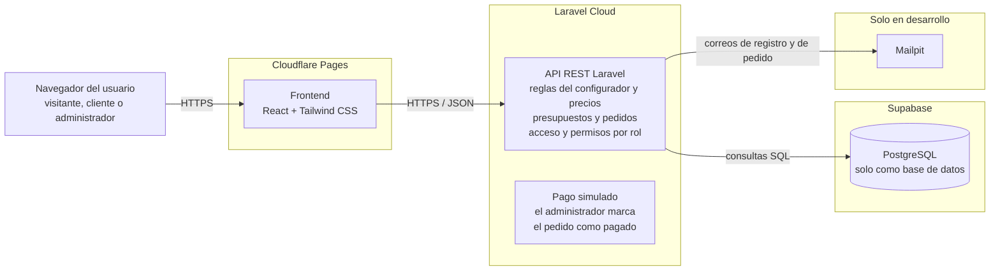
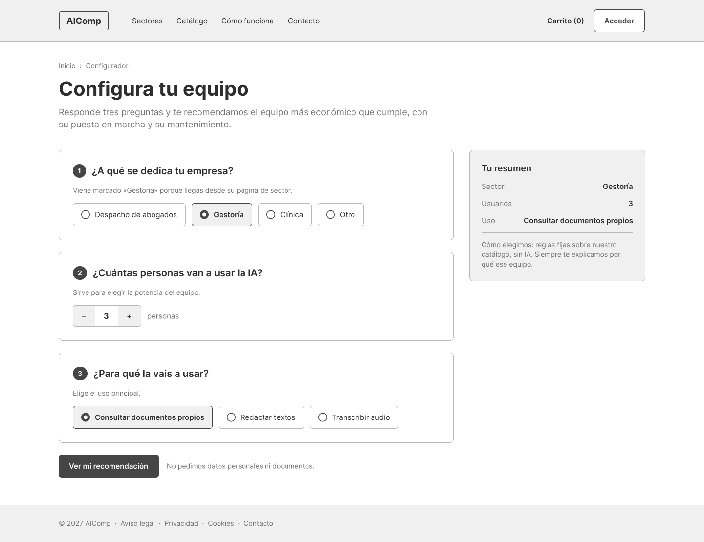
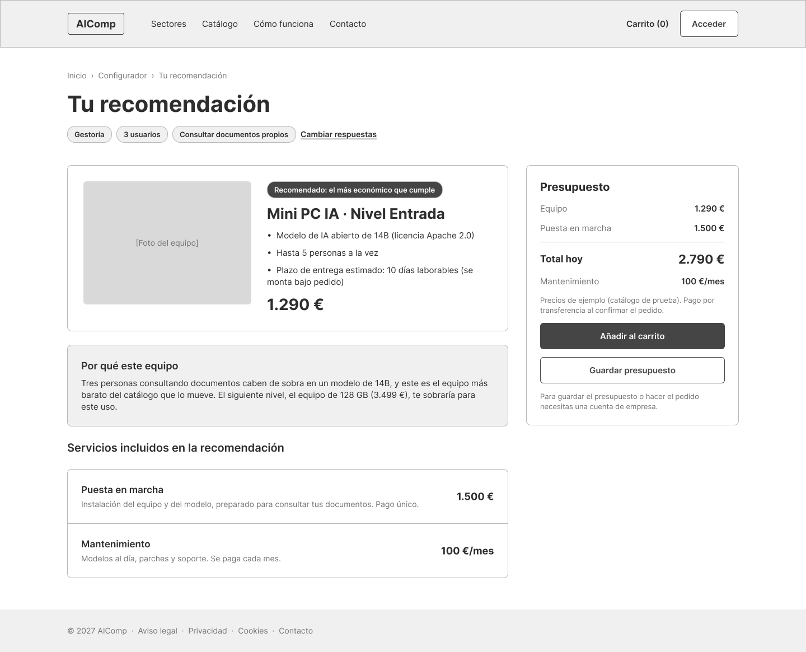

# AIComp · Documentación del proyecto

**La IA de tu empresa, montada a medida y sin salir de tu oficina.**

Equipo DAMN: Daniel Ríos Zea, Álvaro Morón López, Manuel Jesús Jiménez Romero y José Ramón Neira Vega · Proyecto Intermodular 2º DAW · ILERNA Sevilla · 19 de noviembre de 2026

Documento único del proyecto. Reúne en un solo hilo todo lo trabajado en la fase de planificación, sin dividirlo por sprints. La versión completa de cada parte está en los [anexos](#anexos).

| # | Parte |
| --- | --- |
| 1 | [La necesidad](#1-la-necesidad) |
| 2 | [La solución](#2-la-solución) |
| 3 | [Qué nos diferencia](#3-qué-nos-diferencia) |
| 4 | [La plataforma web](#4-la-plataforma-web) |
| 5 | [Diseño: arquitectura, flujos y wireframes](#5-diseño-arquitectura-flujos-y-wireframes) |
| 6 | [Criterios de calidad](#6-criterios-de-calidad) |
| 7 | [Recursos humanos](#7-recursos-humanos) |
| 8 | [Recursos materiales](#8-recursos-materiales) |
| 9 | [Presupuesto](#9-presupuesto) |
| 10 | [Viabilidad](#10-viabilidad) |
| 11 | [Cómo trabajamos](#11-cómo-trabajamos) |
| 12 | [Retrospectiva](#12-retrospectiva) |

---

## 1. La necesidad

**Las pymes quieren usar IA con sus propios documentos, pero no pueden sacar esos datos de la empresa ni tienen a nadie que sepa montarla en casa.**

- **IA en la nube:** los documentos salen de la empresa. Choca con el secreto profesional, el RGPD y la confianza de sus clientes.
- **IA en local:** hay que elegir el hardware, instalar los modelos y conectarlos a los documentos. Las tiendas venden solo piezas, y los integradores son pocos y locales.

| Quién lo sufre | Qué necesita |
| --- | --- |
| **Cliente:** gerentes de autónomos y pymes de 1 a 100 empleados (despachos, gestorías, clínicas, ingenierías) | Una solución con precio cerrado, sin contratar ingenieros de IA |
| **Usuario final:** los empleados que redactan, resumen y buscan información | Un asistente fácil que conozca los documentos de su empresa |
| **Otros afectados:** los clientes de la pyme y los reguladores | Que los datos no salgan de la oficina y que se cumpla la ley |

**Por qué ahora:** el 21,1 % de las empresas con 10 o más empleados ya usa IA, 8,7 puntos más que un año antes (Instituto Nacional de Estadística, 2025, como se citó en Europa Press, 2025). El 91 % de los responsables de TI quiere sus datos en infraestructura propia, privada o híbrida (Cloudian, 2026), y PcComponentes entró en este mercado en octubre de 2026 (Andrés, 2026).

## 2. La solución

**AIComp** vende ordenadores para ejecutar IA dentro de la propia empresa. Llegan con modelos abiertos ya instalados (Qwen, Gemma o Mistral, con licencias de uso comercial; Wevelsiep, 2026) y conectados a los documentos del cliente, con instalación, personalización y mantenimiento.

**Lo que construimos nosotros es la plataforma web de AIComp:** una tienda online con un **configurador que recomienda el equipo según el sector y el caso de uso** (no según las piezas) y un **área de cliente** para seguir pedidos y servicios.

| ✅ Ventajas | ⚠️ Inconvenientes |
| --- | --- |
| Los datos no salen de la oficina | Hardware caro y volátil: la RTX PRO 6000 pasó de 7.628 € a 17.003 € en 12 meses (GPU PRIX, s. f.) |
| Sin cuota por usuario: para 50 usuarios, un equipo de 5.000–8.000 € frente a 10.800 $ al año de Copilot Business (eesel AI, 2026) | Un competidor grande, PcComponentes, ya vende IA local a empresas (Andrés, 2026) |
| Lista para usar: el cliente no necesita ingenieros de IA | No sustituye a la nube en todo: no se integra con Office como Copilot |
| Ingresos recurrentes por los servicios | Los servicios escalan peor que la tienda: dependen de personas |

Descartamos la **nube privada** (el cliente seguiría pagando cada mes y dependiendo de un tercero) y el **renting de equipos** (con precios de GPU tan volátiles, el riesgo del hardware recaería en AIComp).

## 3. Qué nos diferencia

Los modelos locales son la base de AIComp, no lo que la diferencia: todos los competidores analizados ya venden IA local. Lo que nos diferencia es **la combinación de cuatro cosas que hoy nadie une**:

| Diferencial | Qué hace AIComp | Qué hay hoy |
| --- | --- | --- |
| **1. Por sector** | Paquetes para despachos, gestorías y clínicas: modelo, plantillas, cumplimiento y formación de cada profesión | Se vende por hardware, formato o tamaño |
| **2. Un resultado, no un equipo** | El cliente elige «asistente para mi gestoría de 5 personas» y lo recibe con sus documentos ya cargados | Las tiendas venden la máquina |
| **3. La IA no se queda vieja** | Cuota mensual publicada: actualizar modelos, reindexar documentos y soporte remoto en toda España | Mantenimiento a medida y presencial solo en su zona (AIHARD, s. f.) |
| **4. Recomendación independiente** | Ganamos con los servicios, no con el hardware: recomendamos el equipo más barato que cumple | Una tienda gana más cuanto más caro vende |

Es una innovación de proceso, de modelo de negocio y de experiencia de usuario, no tecnológica. La especialización por sector exige conocer la normativa y el día a día de cada profesión: es lo más difícil de copiar para una tienda generalista.

## 4. La plataforma web

### 4.1 Módulos

| Estado | Módulos |
| --- | --- |
| **MVP** (8) | Páginas públicas por sector · Catálogo de equipos · **Configurador por sector y caso de uso** · Cuentas y acceso · Carrito, presupuesto y pedido · Servicios y cuota de mantenimiento · Área de cliente · Panel de administración |
| **Simulados** (3) | Pago (presupuesto y transferencia que el administrador marca como pagada) · Avisos por correo (Mailpit) · Logística y plazos (plazo de entrega en lugar de stock) |
| **Después del MVP** (4) | Demostración con documentos de ejemplo · Correo real · Varios idiomas · App móvil |

### 4.2 Roles de usuario

| Rol | Qué puede hacer |
| --- | --- |
| **Visitante** | Ver las páginas y el catálogo, usar el configurador y ver su presupuesto. Registrarse |
| **Cliente (empresa)** | Guardar presupuestos, confirmar pedidos, contratar la puesta en marcha y el mantenimiento, y seguir sus pedidos. Un usuario por empresa en el MVP |
| **Administrador (AIComp)** | Mantener el catálogo, las reglas del configurador y los servicios; marcar los pedidos como pagados y mover su estado |

### 4.3 El configurador

Pregunta tres datos: **sector, número de usuarios y uso**. La API aplica reglas fijas sobre el catálogo, sin IA, y devuelve **el equipo más económico que cumple**, con una explicación de por qué se ha elegido, más la puesta en marcha y la cuota mensual de mantenimiento. El administrador ajusta el catálogo y las reglas sin tocar código.

**Camino del cliente:** página de sector → configurador → presupuesto → carrito → pedido → área de cliente.

## 5. Diseño: arquitectura, flujos y wireframes

### 5.1 Arquitectura

El frontend solo pinta las pantallas: todo lo decide la API (reglas, precios, pedidos y permisos), así que el resultado no se puede manipular desde el navegador. Supabase se usa solo como base de datos y el acceso lo gestiona Laravel. El camino del cliente y el funcionamiento del configurador tienen su propio diagrama en el [anexo de arquitectura y flujos](../sprint-3/01-architecture.md).

### 5.2 Wireframes

Cinco pantallas clave en baja fidelidad, hechas en [Figma](https://www.figma.com/design/oAk9bo7HjgHIskcGZ9DAah): página de sector, configurador, resultado y presupuesto, área de cliente y panel de pedidos ([anexo de wireframes](../sprint-3/02-wireframes.md)).

## 6. Criterios de calidad

Los 11 módulos del MVP se agrupan en **cinco épicas**, cada una con su Definition of Done e indicadores medibles: un número, un sí/no o una prueba ([anexo de calidad](../sprint-3/03-quality.md)).

| Épica | Ejemplo de indicador |
| --- | --- |
| **E1 Escaparate por sector y catálogo** | De la página de sector al presupuesto en 4 pasos como máximo |
| **E2 Configurador** | El 100 % de las combinaciones de sector y usuarios devuelve un equipo, y siempre el más económico que cumple |
| **E3 Compra** | Sin sesión se crean 0 pedidos; los importes del presupuesto llegan al pedido sin variación |
| **E4 Área de cliente** | Pedir un pedido ajeno devuelve 403 en el 100 % de los intentos |
| **E5 Administración** | Cambiar el catálogo o una regla sin desplegar código: sí/no |

Toda épica cumple además una Definition of Done general: desplegada, sin errores en el flujo principal, usable desde 360 px, permisos probados con los tres roles, Lighthouse de 90 o más en rendimiento y accesibilidad (Chrome for Developers, 2019), reproducible en local y documentada.

## 7. Recursos humanos

Los cuatro miembros del equipo somos los **socios** que dirigen AIComp y **no cobramos**. El trabajo lo hacen profesionales contratados o externos:

| Para… | Puesto | Tipo | Sueldo bruto de referencia |
| --- | --- | --- | --- |
| **Construir la web** (enero a mayo de 2027) | Desarrollador/a frontend y desarrollador/a backend | Contratados | 24.000 € al año (JobRise Team, 2026) |
| | Diseñador/a UI/UX | Externo | 20 €/h, 80 h (UI/UX Jobs Board, s. f.) |
| **Operar AIComp** (desde junio de 2027) | Técnico/a de sistemas e IA | Contratado | 23.000 € al año (Navalon Pascual, 2026) |
| | Comercial y atención al cliente | Contratado | 23.000 € al año (calculadornomina.es, 2026) |
| | Desarrollador/a web de mantenimiento | Contratado, media jornada | 12.000 € al año |
| | Gestoría, protección de datos y prevención de riesgos | Externos | Cuotas mensuales y anuales |

**Dirección:** Sergio Montes, Product Owner y asesor; Dani, Scrum Master; Álvaro, Manuel Jesús y Neira, equipo de desarrollo.

## 8. Recursos materiales

| Pieza | Decisión |
| --- | --- |
| Frontend | React y Tailwind CSS en Cloudflare Pages (plan gratuito) |
| API | Laravel en Laravel Cloud, plan Starter (5 $ al mes; Laravel, s. f.) |
| Base de datos | PostgreSQL en Supabase: gratuito durante el desarrollo y plan Pro en producción (Supabase, s. f.) |
| Entorno local | XAMPP con `pdo_pgsql` y PostgreSQL local |
| Dominio | `aicomp.es` |
| Pagos y correo | Simulados: transferencia marcada a mano y Mailpit |
| Herramientas | VS Code, Git, GitHub con su tablero, Figma y Claude Pro |
| Local | Nave de 150 m² en Sevilla con oficina y taller de montaje, desde mayo de 2027 |
| Equipos | Portátiles y monitores del personal, un NVIDIA DGX Spark y un mini PC de entrada para demostraciones, NAS para copias |

## 9. Presupuesto

Primer año de AIComp, de enero a diciembre de 2027, mes a mes y sin IVA. La versión completa, con supuestos, calendario y fuentes, está en la **[hoja de cálculo del presupuesto](../budget/aicomp-budget.xlsx)**.

| Partida | Total |
| --- | --- |
| Personal contratado | 71.528,38 € |
| Instalaciones (local, suministros, seguros y mobiliario) | 15.275,21 € |
| Equipamiento | 13.201,40 € |
| Marketing y lanzamiento | 7.288,00 € |
| Servicios profesionales externos | 5.413,00 € |
| Software y servicios en la nube | 1.341,15 € |
| Material fungible | 940,00 € |
| Constitución de la SL y marca | 623,88 € |
| **Subtotal** | **115.611,02 €** |
| Contingencias (12 %) | 13.873,32 € |
| **TOTAL** | **129.484,34 €** |

| Fase | Importe con contingencias |
| --- | --- |
| Inversión inicial | 21.855,74 € |
| Construcción de la web (enero a mayo) | 37.272,47 € |
| Operación (junio a diciembre) | 70.356,14 €, unos 10.051 € al mes |

El personal supone el 55 % del total. La fianza del local (1.600 €) va aparte porque se recupera, y los equipos que se venden a los clientes no entran: se compran bajo pedido y son coste de venta.

## 10. Viabilidad

| Ámbito | Riesgo principal | Respuesta |
| --- | --- | --- |
| **Técnico** | Instalar y mantener modelos exige ingeniería de IA; la web, aprender React y Laravel | Procesos por sector y un técnico de IA contratado; web con alcance acotado |
| **Económico** | Margen del hardware bajo y volátil; unos 60.700 € que financiar antes de vender | Montaje bajo pedido, sin stock; el margen sale de los servicios; capital de los socios y préstamo |
| **Legal** | RGPD, AI Act y licencias de modelos | Contrato de encargado del tratamiento; solo modelos Apache 2.0 o MIT (Wevelsiep, 2026) |
| **Operativo** | Plazos de memoria y GPU; soporte presencial que no escala | Plazo de entrega en lugar de stock; soporte remoto en toda España |
| **Mercado** | Grandes como PcComponentes entran con más recursos | Especialización por sector y relación de mantenimiento |

**En cifras** (estimación propia con el presupuesto):

- **Antes de vender** hay que financiar unos **60.700 €**: la inversión inicial, la construcción de la web y la fianza. Una combinación posible es unos 20.000 € de los socios y un préstamo de 40.000 € de la línea Jóvenes Emprendedores de ENISA, que presta de 25.000 a 75.000 € si la empresa aporta fondos propios de al menos la mitad (González, 2025).
- **Cada cliente deja unos 3.500 € el primer año:** unos 800 € del equipo, 1.500 € de la puesta en marcha y 1.200 € de mantenimiento.
- **Operar cuesta unos 108.000 € al año**, así que el punto de equilibrio está en unos **31 clientes al año**, 2,6 al mes. Desde el segundo año, con las renovaciones del mantenimiento, bastan unos **20**.
- El escenario de mercado del pitch, unos 32 equipos al año, queda justo en ese punto: **AIComp es viable, con poco colchón el primer año**, y el mantenimiento recurrente es la pieza clave.

**Si los componentes siguen subiendo** (la DDR5 costaba en julio de 2026 un 448 % más que un año antes; Equipo Editorial blog COOLMOD, 2026): modelos más pequeños y cuantizados, gamas más baratas y, en último caso, solo servicios sobre el equipo del cliente. **Si cambia la IA:** más peso de la puesta en marcha y del mantenimiento, el mismo servicio sobre una nube europea y un catálogo de modelos que no dependa de un solo fabricante.

## 11. Cómo trabajamos

- **Scrum con Kanban:** tres sprints de una semana con roles fijos, revisiones con el Product Owner y una retrospectiva.
- **Tablero:** [AIComp – Board](https://github.com/users/DaniRZ10/projects/1) en GitHub Projects, con las columnas Backlog, To Do (sprint), In Progress, Blocked, Review y Done. Cada tarea es una issue escrita como historia de usuario, con un único responsable, y las tarjetas avanzan solas al abrir y fusionar su PR.
- **Gitflow:** ramas `main`, `develop` y `feature/<issue>-<nombre>`; nada se sube directamente a `main` ni a `develop`.
- **Revisión en dos pasos:** cada persona manda su diff al Scrum Master antes del push; con su OK abre la PR con la plantilla rellena, y solo el Scrum Master la aprueba y la fusiona.
- **Commits** en inglés con Conventional Commits, contenido en español y fuentes en APA 7.

## 12. Retrospectiva

Retrospectiva Sailboat de toda la fase, hecha en [FigJam](https://www.figma.com/board/zJ6QtuY68k8u57T5E9LlMJ/AIComp-%E2%80%93-Retrospectiva-Sailboat?node-id=0-1). Los cuatro destacan como principal viento el flujo de trabajo (ramas, revisión previa y PR), y la roca más clara es que toda la revisión depende de una sola persona. Informe completo en [retrospective.md](retrospective.md).

---

## Anexos

| Parte | Anexo |
| --- | --- |
| Necesidad, solución, diferenciación y viabilidad | [01-need.md](../sprint-1/01-need.md) · [02-solution.md](../sprint-1/02-solution.md) · [03-innovation.md](../sprint-1/03-innovation.md) · [04-feasibility.md](../sprint-1/04-feasibility.md) |
| Módulos, recursos humanos y recursos materiales | [01-modules.md](../sprint-2/01-modules.md) · [02-human-resources.md](../sprint-2/02-human-resources.md) · [03-material-resources.md](../sprint-2/03-material-resources.md) |
| Presupuesto | [aicomp-budget.xlsx](../budget/aicomp-budget.xlsx) |
| Diseño y calidad | [01-architecture.md](../sprint-3/01-architecture.md) · [02-wireframes.md](../sprint-3/02-wireframes.md) · [03-quality.md](../sprint-3/03-quality.md) |
| Revisiones con el Product Owner | [Acta 1](../sprint-1/review-minutes.md) · [Acta 2](../sprint-2/review-minutes.md) |
| Retrospectiva | [retrospective.md](retrospective.md) |
| Presentación final | [presentation.pdf](presentation.pdf) |
| Análisis del sector (Tarea 1) | [pitch.md](../../pitch.md) |

## Referencias

- AIHARD. (s. f.). *Consultoría de IA para empresas en Barcelona*. Recuperado el 10 de noviembre de 2026, de https://www.aihard.es/es/servicios
- Andrés, R. (2026, 13 de octubre). *PcComponentes ha encontrado una forma de exprimir el auge de la IA sin necesidad de apostarlo todo al hardware*. Xataka. https://www.xataka.com/robotica-e-ia/uno-mayores-distribuidores-hardware-espana-ha-tenido-idea-para-seguir-creciendo-convertirse-dell
- calculadornomina.es. (2026, enero). *Sueldo de Comercial / vendedor/a en España 2026: bruto y neto*. https://calculadornomina.es/salarios/sueldo-comercial-espana-2026/
- Chrome for Developers. (2019, 19 de septiembre). *Lighthouse performance scoring*. https://developer.chrome.com/docs/lighthouse/performance/performance-scoring
- Cloudian. (2026, 3 de marzo). *Enterprise survey finds 93% are repatriating AI workloads or evaluating a move away from public cloud* [Nota de prensa]. https://cloudian.com/press/enterprise-repatriating-ai-workloads/
- eesel AI. (2026, 7 de mayo). *Copilot pricing 2026: Business, Enterprise plans compared*. https://www.eesel.ai/blog/copilot-pricing
- Equipo Editorial blog COOLMOD. (2026, 15 de septiembre). *Por qué ha subido el precio de la RAM y qué implica para quienes quieren comprar un PC*. Blog COOLMOD. https://www.coolmod.com/blog/categorias/componentes/por-que-ha-subido-el-precio-de-la-ram-y-que-implica-para-quienes-quieren-comprar-un-pc/
- Europa Press. (2025, 22 de octubre). *Economía.- El 21,1% de empresas en España de 10 o más empleados usó la IA en el primer trimestre del año, según el INE*. Bolsamanía. https://www.bolsamania.com/noticias/empresas/economia--el-211-de-empresas-en-espana-de-10-o-mas-empleados-uso-la-ia-en-el-primer-trimestre-del-ano-segun-el-ine--21080387.html
- González, G. (2025, 30 de mayo). *Línea ENISA para jóvenes emprendedores*. Legálitas. https://www.legalitas.com/actualidad/enisa-jovenes-emprendedores
- GPU PRIX. (s. f.). *RTX PRO 6000 Blackwell price in Spain: History, deals & specs*. Recuperado el 18 de octubre de 2026, de https://gpuprix.com/spain/gpus/rtx-pro-6000-blackwell
- JobRise Team. (2026, 20 de mayo). *Salario Developer Junior en España 2026*. JobRise. https://jobrise.io/es/blog/salario-developer-junior-espana-2026/
- Laravel. (s. f.). *Plans and pricing*. Laravel Cloud. Recuperado el 12 de noviembre de 2026, de https://laravel.com/cloud/docs/pricing
- Navalon Pascual, E. (2026, 17 de febrero). *¿Cuánto gana un Técnico en Sistemas Microinformáticos 2026?* ILERNA. https://www.ilerna.es/blog/salario-sistemas-microinformaticos-redes
- Supabase. (s. f.). *Pricing & fees*. Recuperado el 19 de noviembre de 2026, de https://supabase.com/pricing
- UI/UX Jobs Board. (s. f.). *UI/UX designer salary in Spain 2026*. Recuperado el 12 de noviembre de 2026, de https://uiuxjobsboard.com/salary/ui-ux-designer/spain
- Wevelsiep, T. (2026, 12 de octubre). *Open LLM licences for commercial use: Apache 2.0, MIT, Llama, Qwen, Mistral*. WZ-IT. https://wz-it.com/en/knowledge/ki/open-llm-licenses-commercial-use/

El resto de referencias, en cada anexo y en la hoja Fuentes del presupuesto.
