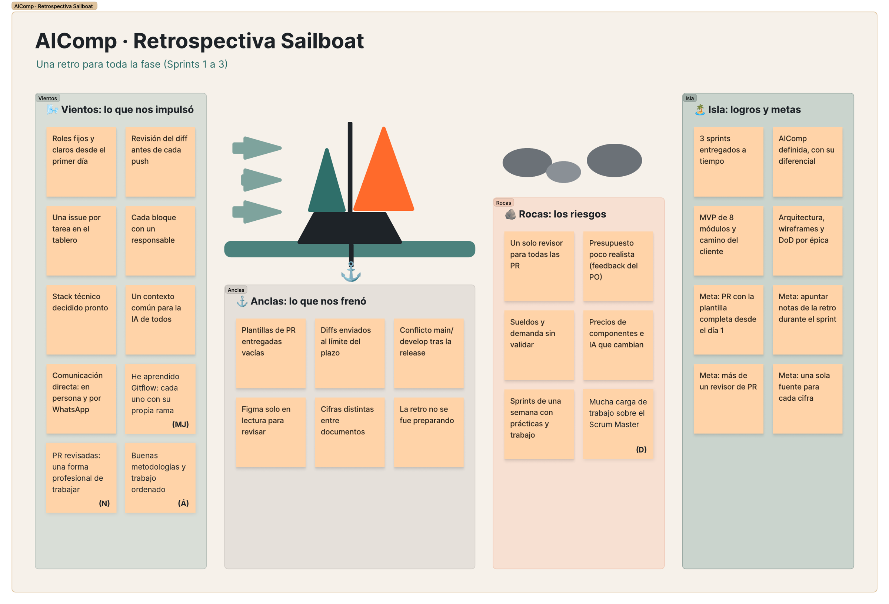

# Informe de la retrospectiva

| Dato | Valor |
| --- | --- |
| Alcance | Toda la fase de planificación: Sprints 1, 2 y 3 |
| Formato | Sailboat: vientos, anclas, rocas e isla |
| Fecha | 19 de noviembre de 2026 |
| Participantes | Daniel Ríos Zea (Scrum Master), Álvaro Morón López, Manuel Jesús Jiménez Romero y José Ramón Neira Vega |
| Tablero | [AIComp – Retrospectiva Sailboat (FigJam)](https://www.figma.com/board/zJ6QtuY68k8u57T5E9LlMJ/AIComp-%E2%80%93-Retrospectiva-Sailboat?node-id=0-1) |

## 1. Lo que salió en el tablero

| Zona | Lo más importante |
| --- | --- |
| 🌬️ **Vientos** (lo que nos impulsó) | Roles fijos y claros desde el primer día; revisión del diff antes de cada push; una issue por tarea en el tablero; cada bloque con un responsable; stack técnico decidido pronto; comunicación directa en persona y por WhatsApp |
| ⚓ **Anclas** (lo que nos frenó) | Plantillas de PR entregadas vacías; diffs enviados al límite del plazo; el conflicto entre `main` y `develop` tras la primera release; Figma solo en lectura para revisar; cifras distintas entre documentos; la retro no se fue preparando durante la fase |
| 🪨 **Rocas** (los riesgos) | Un solo revisor para todas las PR, con mucha carga sobre el Scrum Master; un presupuesto poco realista, que corrigió el Product Owner; sueldos y demanda sin validar; precios de componentes e IA que cambian; sprints de una semana compaginados con prácticas y trabajo |
| 🏝️ **Isla** (logros y metas) | Tres sprints entregados; AIComp definida, con su diferencial; un MVP de 8 módulos con su camino del cliente; arquitectura, wireframes y Definition of Done por épica |

## 2. Coevaluación: lo que dice cada uno

| Miembro | Valoración |
| --- | --- |
| **Manuel Jesús** | Ha aprendido Gitflow, con una rama de trabajo para cada uno, algo que no conocía de cursos anteriores. Valora una metodología que minimiza los errores: cada tarea la revisa el Scrum Master antes de subirla. |
| **Neira** | Ha aprendido a montar proyectos en un entorno que evita errores y malas prácticas, a entender Gitflow, a redactar bien los commits y a ser más organizado. Se ha adaptado a trabajar con pull requests revisadas, una forma de trabajar que ve profesional. El equipo va con una idea clara y sólida de un proyecto complejo. |
| **Álvaro** | Valoración positiva en general: contento con el uso de buenas metodologías y con trabajar de forma ordenada. |
| **Dani** | Comparte la valoración positiva del equipo, aunque ha tenido bastante carga de trabajo como único revisor y responsable de la integración. |

**Lectura conjunta:** los cuatro destacan lo mismo como viento principal, el flujo de trabajo (ramas, revisión previa y PR). La misma pieza es también la roca más clara: toda la revisión pasa por una sola persona.

## 3. Aprendizajes clave

1. **Un flujo profesional desde el principio compensa.** Gitflow con revisión del diff antes del push evitó romper `develop` en tres sprints, y el equipo lo ha interiorizado.
2. **Las cifras necesitan una sola fuente.** Dos documentos con el mismo dato distinto (el sueldo del técnico) y un presupuesto con pocas partidas fueron las dos correcciones de peso. El presupuesto vive ahora en una única hoja de cálculo y el resto de documentos la enlazan.
3. **La revisión no puede depender de una persona.** Funcionó, pero con mucha carga y entregas al límite.
4. **La retro se prepara durante el sprint, no al final.** La issue de notas se abrió en el Sprint 1 y no se usó hasta el cierre.

## 4. Metas para la siguiente fase

| Meta | Cómo se comprueba | Responsable |
| --- | --- | --- |
| PR con la plantilla completa desde el primer día | Ninguna PR se fusiona con la plantilla vacía | Quien abre la PR |
| Más de un revisor | Cada PR la revisa otro desarrollador antes del Scrum Master | Todos, por turnos |
| Diffs con margen | El diff llega al menos 24 horas antes de la entrega | Cada responsable |
| Notas de la retro durante el sprint | Al menos una nota por persona y sprint en la issue de la retro | Todos |
| Una sola fuente para cada cifra | Los documentos enlazan al presupuesto en lugar de copiar cifras | Scrum Master |
