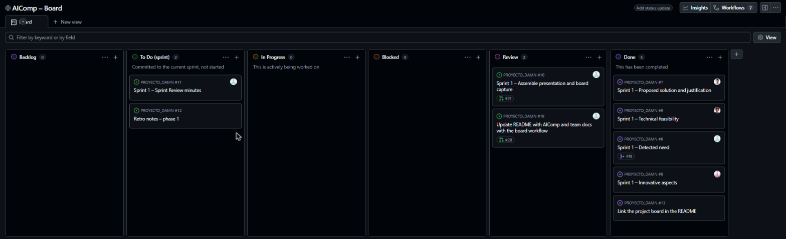

# AIComp · Sprint 1: Descubrimiento y definición

**La IA de tu empresa, montada a medida y sin salir de tu oficina.**

Equipo DAMN (Dani, Álvaro, Manuel Jesús y Neira) · Proyecto Intermodular 2º DAW · ILERNA Sevilla · 29 de octubre de 2026
Tablero del sprint: [AIComp – Board](https://github.com/users/DaniRZ10/projects/1)

| Slide | Bloque |
| --- | --- |
| 1 | [Necesidad detectada](#1-necesidad-detectada) |
| 2 | [Propuesta de solución](#2-propuesta-de-solución) |
| 3 | [Justificación de la solución](#3-justificación-de-la-solución) |
| 4 | [Aspectos innovadores](#4-aspectos-innovadores) |
| 5 | [Viabilidad técnica](#5-viabilidad-técnica) |

---

## 1. Necesidad detectada

**Las pymes quieren usar IA con sus propios documentos, pero no pueden sacar esos datos de la empresa ni tienen a nadie que sepa montarla en casa.**

- **IA en la nube:** los documentos salen de la empresa. Choca con el secreto profesional, el RGPD y la confianza de sus clientes.
- **IA en local:** hay que elegir el hardware, instalar los modelos y conectarlos a los documentos. Las tiendas venden solo piezas, y los integradores son pocos y locales.

| Quién lo sufre | Qué necesita |
| --- | --- |
| **Cliente:** gerentes de autónomos y pymes de 1 a 100 empleados (despachos, gestorías, clínicas, ingenierías) | Una solución con precio cerrado, sin contratar ingenieros de IA |
| **Usuario final:** los empleados que redactan, resumen y buscan información | Un asistente fácil que conozca los documentos de su empresa |
| **Otros afectados:** los clientes de la pyme y los reguladores | Que los datos no salgan de la oficina y que se cumpla la ley |

**Por qué ahora:** el 21,1 % de las empresas con 10 o más empleados ya usa IA (+8,7 puntos en un año) [1]; el 91 % de los responsables de TI quiere sus datos en infraestructura propia, privada o híbrida [2]; la falta de conocimiento es el primer freno [3]; y PcComponentes entró en este mercado en octubre de 2026 [4].

---

## 2. Propuesta de solución

**AIComp** vende ordenadores para ejecutar IA dentro de la propia empresa, montados de serie o personalizados. Llegan con modelos abiertos ya instalados (Llama, Qwen, Gemma, Mistral) y adaptados a los documentos del cliente, con servicios de instalación, personalización y mantenimiento.

**Lo que construimos nosotros:** la plataforma web de AIComp. Es una tienda online, con un **configurador que recomienda el equipo según el caso de uso** (no según las piezas) y un **área de cliente** para seguir pedidos y servicios.

| ✅ Ventajas | ⚠️ Inconvenientes |
| --- | --- |
| **Los datos no salen de la oficina:** es lo que pide el mercado [2] | **Hardware caro y volátil:** la RTX PRO 6000 pasó de 7.628 € a 17.003 € en 12 meses [5] |
| **Sin cuota por usuario:** para 50 usuarios, un equipo de 5.000–8.000 € frente a 10.800 $ al año de Copilot Business [6] | **Competidor grande:** PcComponentes (825 M€ de ventas en 2025) ya vende IA local a empresas [4] |
| **Lista para usar:** el cliente no necesita ingenieros de IA | **No sustituye a la nube en todo:** un modelo local no se integra con Office como Copilot |
| **Ingresos recurrentes:** los servicios estabilizan un margen de hardware frágil | **Los servicios escalan peor que la tienda:** dependen de personas |

---

## 3. Justificación de la solución

| Criterio | Por qué AIComp lo cumple |
| --- | --- |
| **Coste para el cliente** | Un equipo por tamaño: de 550–1.840 € para un autónomo a 5.000–8.000 € para 50 usuarios, del orden de un año de suscripción en la nube |
| **Privacidad de los datos** | Los datos se procesan en la oficina del cliente, lo que facilita cumplir el RGPD y el AI Act |
| **Complejidad técnica para nosotros** | Construimos la web, no los equipos, con el stack propuesto (React, Laravel y Tailwind). La pieza más compleja es el configurador |
| **Escalabilidad** | Una sola web y un catálogo por niveles, del mini PC al servidor. Se vende online en toda España |
| **Encaje con el mercado** | Ocupa el hueco entre la tienda que solo vende hardware y la consultoría local; la entrada de PcComponentes confirma la demanda |

Descartamos la **nube privada**, porque el cliente seguiría pagando cada mes y dependiendo de un tercero, y el **renting de equipos**, porque con precios de GPU tan volátiles el riesgo del hardware recaería en AIComp.

---

## 4. Aspectos innovadores

| Empresa | Qué ofrece | Qué aporta AIComp |
| --- | --- | --- |
| VORLUX AI | Asesoría y formación; recomienda equipos, no los vende montados | El equipo montado, con modelos y mantenimiento |
| AIHARD | Equipo, modelos y mantenimiento, a domicilio solo en la zona de Barcelona | Venta online a toda España |
| Coolmod | Tienda de hardware y PCs a medida, sin mantenimiento | Modelos adaptados a los documentos y mantenimiento propio |
| PcComponentes | Equipos de IA local para empresas desde octubre de 2026 | Configurador por caso de uso y modelos ya adaptados |
| Dell | Servidores y consultoría para grandes empresas | Foco en la pyme |

- **Proceso:** configurador por caso de uso («asistente para un despacho de 3 personas») en lugar de por pieza.
- **Modelo de negocio:** solución completa (equipo + modelos + mantenimiento) vendida online a pymes de toda España.
- **Experiencia de usuario:** el equipo funciona desde el primer día con los documentos del cliente (RAG), sin saber de IA.

No es innovación tecnológica: usamos hardware y modelos abiertos que ya existen. **Lo nuevo es cómo se combinan y se venden.**

---

## 5. Viabilidad técnica

Viabilidad de la **plataforma web** de AIComp, no del montaje de los equipos.

| Ámbito | Qué tenemos | Qué falta / riesgo |
| --- | --- | --- |
| **Tecnología** | Stack previsto: React + Tailwind CSS, Laravel (API REST) y **PostgreSQL en Supabase**; Git, GitHub y GitHub Projects funcionando | Nadie ha usado React ni Laravel en un proyecto real. Supabase solo como base de datos; el plan gratuito se pausa tras una semana sin uso [8] |
| **Infraestructura** | Portátiles propios; frontend en Cloudflare Pages o Vercel [7] | Entorno local abierto (XAMPP o Docker). La API Laravel necesita un hosting con PHP: pendiente del Sprint 2 |
| **Competencias** | HTML, CSS, JavaScript, PHP, SQL, Java y Git básico | Aprender React, Laravel y despliegue; nivel desigual en el equipo |
| **Limitaciones** | Sprints de una semana con pocas horas por persona | Pendiente del Sprint 2: qué se simula (pagos, stock, envíos), qué queda fuera, el correo y los pagos |

**Conclusión:** la plataforma es viable con herramientas gratuitas si acotamos el alcance y reservamos tiempo para aprender React y Laravel. Propuesta de MVP, a validar con el PO en el Sprint 2: catálogo, configurador, área de cliente, carrito, pedido y panel de administración básico.

---

## Tablero del sprint

## Anexos (versión completa de cada bloque)

- [Bloque 1 – Necesidad detectada](01-need.md)
- [Bloque 2 – Propuesta de solución](02-solution.md)
- [Bloque 3 – Aspectos innovadores](03-innovation.md)
- [Bloque 4 – Viabilidad técnica](04-feasibility.md)
- [Pitch de la Tarea 1: análisis del sector](../../pitch.md)

Fuentes (consultadas en octubre de 2026): [1] [INE, vía Bolsamanía](https://www.bolsamania.com/noticias/empresas/economia--el-211-de-empresas-en-espana-de-10-o-mas-empleados-uso-la-ia-en-el-primer-trimestre-del-ano-segun-el-ine--21080387.html) · [2] [Cloudian](https://cloudian.com/press/enterprise-repatriating-ai-workloads/) · [3] [Eurostat 2025, vía Euronews](https://es.euronews.com/next/2026/05/25/por-que-las-empresas-europeas-no-usan-herramientas-de-ia) · [4] [Xataka](https://www.xataka.com/robotica-e-ia/uno-mayores-distribuidores-hardware-espana-ha-tenido-idea-para-seguir-creciendo-convertirse-dell) · [5] [GPUPrix](https://gpuprix.com/spain/gpus/rtx-pro-6000-blackwell) · [6] [eesel: precios de Copilot](https://www.eesel.ai/blog/copilot-pricing) · [7] [Vercel: plan Hobby](https://vercel.com/docs/plans/hobby) · [8] [Límites del plan gratuito de Supabase (2026)](https://automationatlas.io/answers/supabase-free-tier-limits-2026/). El resto de fuentes, en cada anexo.
