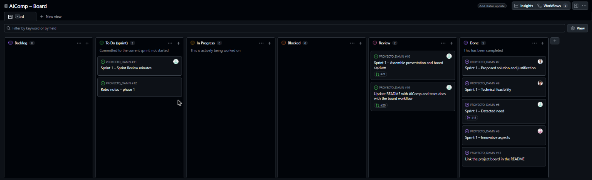

# AIComp · Sprint 1: Descubrimiento y definición

**La IA de tu empresa, montada a medida y sin salir de tu oficina.**

Equipo DAMN (Dani, Álvaro, Manuel Jesús y Neira) · Proyecto Intermodular 2º DAW · ILERNA Sevilla · 29 de octubre de 2026, revisada el 10 de noviembre de 2026 tras la Sprint Review ([acta](review-minutes.md))
Tablero del sprint: [AIComp – Board](https://github.com/users/DaniRZ10/projects/1)

| Slide | Bloque |
| --- | --- |
| 1 | [Necesidad detectada](#1-necesidad-detectada) |
| 2 | [Propuesta de solución](#2-propuesta-de-solución) |
| 3 | [Justificación de la solución](#3-justificación-de-la-solución) |
| 4 | [Aspectos innovadores](#4-aspectos-innovadores) |
| 5 | [Viabilidad](#5-viabilidad) |

---

## 1. Necesidad detectada

**Las pymes quieren usar IA con sus propios documentos, pero no pueden sacar esos datos de la empresa ni tienen a nadie que sepa montarla en casa.**

- **IA en la nube:** los documentos salen de la empresa. Choca con el secreto profesional, el RGPD y la confianza de sus clientes.
- **IA en local:** hay que elegir el hardware, instalar los modelos y conectarlos a los documentos. Las tiendas venden solo piezas, y los integradores son pocos y locales.

| Quién lo sufre | Qué necesita |
| --- | --- |
| **Cliente:** gerentes de autónomos y pymes de 1 a 100 empleados (despachos, gestorías, clínicas, ingenierías) | Una solución con precio cerrado, sin contratar ingenieros de IA |
| **Usuario final:** los empleados que redactan, resumen y buscan información | Un asistente fácil que conozca los documentos de su empresa |
| **Otros afectados:** los clientes de la pyme y los reguladores | Que los datos no salgan de la oficina y que se cumpla la ley |

**Por qué ahora:** el 21,1 % de las empresas con 10 o más empleados ya usa IA (+8,7 puntos en un año; Instituto Nacional de Estadística, 2025, como se citó en Europa Press, 2025); el 91 % de los responsables de TI quiere sus datos en infraestructura propia, privada o híbrida (Cloudian, 2026); la falta de conocimiento es el primer freno (Eurostat, 2025, como se citó en Markeviciute, 2026); y PcComponentes entró en este mercado en octubre de 2026 (Andrés, 2026).

---

## 2. Propuesta de solución

**AIComp** vende ordenadores para ejecutar IA dentro de la propia empresa, montados de serie o personalizados. Llegan con modelos abiertos ya instalados (Qwen, Gemma o Mistral, con licencias de uso comercial; Wevelsiep, 2026) y adaptados a los documentos del cliente, con servicios de instalación, personalización y mantenimiento.

**Lo que construimos nosotros:** la plataforma web de AIComp. Es una tienda online, con un **configurador que recomienda el equipo según el caso de uso** (no según las piezas) y un **área de cliente** para seguir pedidos y servicios.

**Cómo funciona:**

- **Compra por caso de uso:** el cliente describe lo que necesita («asistente para un despacho de 3 personas») y el dimensionado lo hacemos nosotros.
- **Solución completa:** equipo, modelos y mantenimiento, vendidos online a pymes de toda España.
- **Lista desde el primer día:** los modelos llegan conectados a los documentos del cliente (RAG), sin que tenga que saber de IA.

| ✅ Ventajas | ⚠️ Inconvenientes |
| --- | --- |
| **Los datos no salen de la oficina:** es lo que pide el mercado (Cloudian, 2026) | **Hardware caro y volátil:** la RTX PRO 6000 pasó de 7.628 € a 17.003 € en 12 meses (GPU PRIX, s. f.) |
| **Sin cuota por usuario:** para 50 usuarios, un equipo de 5.000–8.000 € frente a 10.800 $ al año de Copilot Business (eesel AI, 2026) | **Competidor grande:** PcComponentes (825 M€ de ventas en 2025) ya vende IA local a empresas (Andrés, 2026) |
| **Lista para usar:** el cliente no necesita ingenieros de IA | **No sustituye a la nube en todo:** un modelo local no se integra con Office como Copilot |
| **Ingresos recurrentes:** los servicios estabilizan un margen de hardware frágil | **Los servicios escalan peor que la tienda:** dependen de personas |

---

## 3. Justificación de la solución

| Criterio | Por qué AIComp lo cumple |
| --- | --- |
| **Coste para el cliente** | Un equipo por tamaño: de 550–1.840 € para un autónomo a 5.000–8.000 € para 50 usuarios, del orden de un año de suscripción en la nube |
| **Privacidad de los datos** | Los datos se procesan en la oficina del cliente, lo que facilita cumplir el RGPD y el AI Act |
| **Complejidad técnica para nosotros** | Construimos la web, no los equipos, con el stack propuesto (React, Laravel y Tailwind). La pieza más compleja es el configurador |
| **Escalabilidad** | Una sola web y un catálogo por niveles, del mini PC al servidor. Se vende online en toda España |
| **Encaje con el mercado** | Ocupa el hueco entre la tienda que solo vende hardware y la consultoría local; la entrada de PcComponentes confirma la demanda |

**Frente a la oferta actual:**

| Empresa | Qué ofrece hoy | Qué deja sin cubrir |
| --- | --- | --- |
| VORLUX AI | Asesoría y formación; recomienda equipos, no los vende montados | El equipo montado, con modelos y mantenimiento |
| AIHARD | Equipo, modelos y mantenimiento; presencial solo en la zona de Barcelona (AIHARD, s. f.) | Una oferta pensada para toda España |
| Coolmod | Tienda de hardware y PCs a medida, sin mantenimiento | Modelos adaptados a los documentos y mantenimiento |
| PcComponentes | Equipos de IA local por formato y uso, con calculadora y presupuestos para empresas (PcComponentes, s. f.) | Soluciones pensadas para un sector concreto |
| Dell | Servidores y consultoría para grandes empresas | La pyme |

Descartamos la **nube privada**, porque el cliente seguiría pagando cada mes y dependiendo de un tercero, y el **renting de equipos**, porque con precios de GPU tan volátiles el riesgo del hardware recaería en AIComp.

---

## 4. Aspectos innovadores

**Los modelos locales son la base de AIComp, no lo que la diferencia:** todos los competidores analizados ya venden IA local, y PcComponentes busca vender soluciones listas para funcionar (PcComponentes, 2026). Lo que nos diferencia es la combinación de cuatro cosas que hoy nadie une:

| Diferencial | Qué hace AIComp | Qué hay hoy |
| --- | --- | --- |
| **1. Por sector** | Paquetes para despachos, gestorías y clínicas: modelo, plantillas, cumplimiento y formación de cada profesión | Las cinco empresas analizadas venden por hardware, formato o tamaño |
| **2. Un resultado, no un equipo** | El cliente elige «asistente para mi gestoría de 5 personas», lo prueba con documentos de ejemplo de su sector y lo recibe con sus documentos ya cargados | Las tiendas venden la máquina |
| **3. La IA no se queda vieja** | Cuota mensual publicada que incluye actualizar modelos, reindexar documentos y soporte remoto en toda España | AIHARD lo hace a medida y presencial solo en su zona (AIHARD, s. f.) |
| **4. Recomendación independiente** | Ganamos con los servicios, no con el hardware: recomendamos el equipo más barato que cumple, de cualquier marca | Una tienda gana más cuanto más caro vende |

**Tipo de innovación:** de proceso, modelo de negocio y experiencia de usuario; no tecnológica.
**Por qué es defendible:** la especialización por sector exige conocer la normativa y el día a día de cada profesión, y es lo más difícil de copiar para una tienda generalista.

---

## 5. Viabilidad

Viabilidad de crear y operar AIComp, no solo de construir su web. Las cifras sin fuente son estimaciones propias.

| Ámbito | Riesgo principal | Respuesta |
| --- | --- | --- |
| **Técnico** | Instalar y mantener modelos exige ingeniería de IA; la web, aprender React y Laravel | Procesos por sector e ingeniería de IA contratada o subcontratada; web con planes gratuitos y alcance acotado |
| **Económico** | Margen del hardware bajo y volátil | Montaje bajo pedido, sin stock; el margen sale de los servicios |
| **Legal** | RGPD, AI Act y licencias de modelos | Contrato de encargado del tratamiento; solo modelos Apache 2.0 o MIT (Wevelsiep, 2026) |
| **Operativo** | Plazos de memoria y GPU; soporte presencial que no escala | Plazo de entrega en lugar de stock; soporte remoto en toda España |
| **Mercado** | Grandes como PcComponentes entran con más recursos | Especialización por sector y relación de mantenimiento |

**En cifras:** unos 19.000 € de inversión inicial, unos 3.500 € de margen por cliente el primer año y el punto de equilibrio en unos 14 clientes al año con un técnico contratado (Indeed, s. f.; detalle en el anexo).

**Si los componentes siguen subiendo** (la DDR5 costaba en julio de 2026 un 448 % más que un año antes, y la escasez puede durar hasta 2028–2030; Equipo Editorial blog COOLMOD, 2026; Kleinbaum, 2026; 3dpoder, 2026): modelos más pequeños y cuantizados, gamas más baratas (un mini PC AMD desde 2.629 €, frente a los 6.999 € de un DGX Spark; PcComponentes, s. f.) y, en último caso, solo servicios sobre el equipo del cliente.

**Si cambia la IA** (modelos que caben en cualquier portátil, nube privada más barata o licencias nuevas): más peso de la puesta en marcha y del mantenimiento, el mismo servicio sobre una nube europea y un catálogo de modelos que no dependa de un solo fabricante.

**Conclusión:** AIComp es viable si vive de los servicios y no del stock. Si el hardware o la IA cambian, el negocio de servicios sigue en pie.

---

## Tablero del sprint

## Anexos (versión completa de cada bloque)

- [Bloque 1 – Necesidad detectada](01-need.md)
- [Bloque 2 – Propuesta de solución](02-solution.md)
- [Bloque 3 – Aspectos innovadores](03-innovation.md)
- [Bloque 4 – Viabilidad](04-feasibility.md)
- [Acta de la Sprint Review](review-minutes.md)
- [Pitch de la Tarea 1: análisis del sector](../../pitch.md)

## Referencias

- AIHARD. (s. f.). *Consultoría de IA para empresas en Barcelona*. Recuperado el 10 de noviembre de 2026, de https://www.aihard.es/es/servicios
- Andrés, R. (2026, 13 de octubre). *PcComponentes ha encontrado una forma de exprimir el auge de la IA sin necesidad de apostarlo todo al hardware*. Xataka. https://www.xataka.com/robotica-e-ia/uno-mayores-distribuidores-hardware-espana-ha-tenido-idea-para-seguir-creciendo-convertirse-dell
- Cloudian. (2026, 3 de marzo). *Enterprise survey finds 93% are repatriating AI workloads or evaluating a move away from public cloud* [Nota de prensa]. https://cloudian.com/press/enterprise-repatriating-ai-workloads/
- eesel AI. (2026, 7 de mayo). *Copilot pricing 2026: Business, Enterprise plans compared*. https://www.eesel.ai/blog/copilot-pricing
- Equipo Editorial blog COOLMOD. (2026, 15 de septiembre). *Por qué ha subido el precio de la RAM y qué implica para quienes quieren comprar un PC*. Blog COOLMOD. https://www.coolmod.com/blog/categorias/componentes/por-que-ha-subido-el-precio-de-la-ram-y-que-implica-para-quienes-quieren-comprar-un-pc/
- Europa Press. (2025, 22 de octubre). *Economía.- El 21,1% de empresas en España de 10 o más empleados usó la IA en el primer trimestre del año, según el INE*. Bolsamanía. https://www.bolsamania.com/noticias/empresas/economia--el-211-de-empresas-en-espana-de-10-o-mas-empleados-uso-la-ia-en-el-primer-trimestre-del-ano-segun-el-ine--21080387.html
- GPU PRIX. (s. f.). *RTX PRO 6000 Blackwell price in Spain: History, deals & specs*. Recuperado el 18 de octubre de 2026, de https://gpuprix.com/spain/gpus/rtx-pro-6000-blackwell
- Indeed. (s. f.). *Salario de técnico/a de sistemas en España*. Recuperado el 10 de noviembre de 2026, de https://es.indeed.com/salaries/t%C3%A9cnico-de-sistemas-Salaries
- Kleinbaum, T. (2026, 8 de noviembre). *SK Hynix triplica ingresos y Samsung bate récord: la RAM subirá hasta un 15 % este invierno*. Tendencias en la Red. https://www.netz-trends.de/es/sk-hynix-samsung-dram-sube-precio-invierno-2026/
- Markeviciute, E. (2026, 25 de mayo). *Por qué las empresas europeas todavía no aprovechan las herramientas de IA*. Euronews. https://es.euronews.com/next/2026/05/25/por-que-las-empresas-europeas-no-usan-herramientas-de-ia
- PcComponentes. (s. f.). *PCs para IA local: portátiles, mini PC y sobremesa*. Recuperado el 10 de noviembre de 2026, de https://www.pccomponentes.com/categorias/ordenadores/ia-local
- PcComponentes. (2026, 18 de septiembre). *AI Computing Solutions Lead* [Oferta de empleo]. https://jobs.pccomponentes.com/jobs/8402926-ai-computing-solutions-lead
- 3dpoder. (2026, 7 de noviembre). *Team Group avisa: la escasez de memoria DDR5 se agrava hasta 2027*. Foro3D. https://foro3d.com/2026/noviembre/team-group-avisa-la-escasez-de-memoria-ddr5-se-agrava-hasta-2027.html
- Wevelsiep, T. (2026, 12 de octubre). *Open LLM licences for commercial use: Apache 2.0, MIT, Llama, Qwen, Mistral*. WZ-IT. https://wz-it.com/en/knowledge/ki/open-llm-licenses-commercial-use/

El resto de referencias, en cada anexo.
