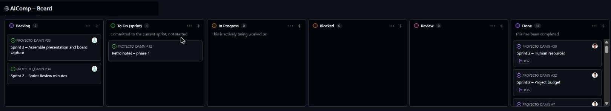

# AIComp · Sprint 2: Estructuración y planificación

**La IA de tu empresa, montada a medida y sin salir de tu oficina.**

Equipo DAMN (Dani, Álvaro, Manuel Jesús y Neira) · Proyecto Intermodular 2º DAW · ILERNA Sevilla · 12 de noviembre de 2026
Tablero del sprint: [AIComp – Board](https://github.com/users/DaniRZ10/projects/1)

| Slide | Bloque |
| --- | --- |
| 1 | [Feedback incorporado](#1-feedback-incorporado) |
| 2 | [Módulos y su integración](#2-módulos-y-su-integración) |
| 3 | [Recursos humanos](#3-recursos-humanos) |
| 4 | [Recursos materiales](#4-recursos-materiales) |
| 5 | [Presupuesto](#5-presupuesto) |

El diseño (diagramas, esquemas, prototipos y wireframes) queda aplazado al Sprint 3 por indicación del Product Owner.

---

## 1. Feedback incorporado

Qué cambió tras la Sprint Review del 3 de noviembre ([acta](../sprint-1/review-minutes.md)):

| Feedback del PO | Qué hicimos | Dónde |
| --- | --- | --- |
| La viabilidad debe ser de toda la empresa, con soluciones y alternativas | Viabilidad por ámbitos, con cifras estimadas y escenarios si suben los componentes o cambia la IA | [Viabilidad](../sprint-1/04-feasibility.md) |
| La innovación debe centrarse en la diferenciación real | Cuatro diferenciales combinados: soluciones por sector, un resultado en lugar de un equipo, modelos siempre al día y recomendación independiente. El contenido anterior pasó a la solución | [Innovación](../sprint-1/03-innovation.md) |
| Fuentes en APA 7 | Toda la documentación, y cada fuente nueva | Todos los bloques |

**Cómo condiciona este sprint:** el configurador pasa a ser por sector, y AIComp vive de los servicios, no del stock. Además, el equipo decidió que los cuatro somos los socios que dirigen el proyecto: el trabajo lo hacen profesionales contratados o externos, y sus sueldos y honorarios entran en el presupuesto.

---

## 2. Módulos y su integración

| Módulo | Qué hace | Estado |
| --- | --- | --- |
| Páginas públicas por sector | Explican el diferencial y llevan al configurador | MVP |
| Catálogo de equipos | Equipos por nivel, con datos de ejemplo | MVP |
| **Configurador por sector y caso de uso** | Tres preguntas (sector, usuarios y uso) y reglas sobre el catálogo: devuelve el equipo más económico que cumple, la puesta en marcha y la cuota de mantenimiento | MVP |
| Cuentas y acceso | Registro de la empresa y permisos por rol | MVP |
| Carrito, presupuesto y pedido | Convierte la recomendación en presupuesto y en pedido | MVP |
| Servicios y cuota de mantenimiento | Se muestran y se contratan junto al equipo | MVP |
| Área de cliente | Pedidos, presupuestos y servicios contratados | MVP |
| Panel de administración | Catálogo, reglas del configurador y pedidos | MVP |
| Pago, avisos por correo, y logística y plazos | Transferencia marcada a mano, Mailpit y plazo de entrega en lugar de stock | Simulado |
| Demostración con documentos, correo real, idiomas y app móvil | — | Después |

- **Roles de usuario:** visitante, cliente (empresa) y administrador.
- **Camino del MVP:** página de sector → configurador → presupuesto → carrito → pedido → área de cliente.
- **Integración:** el frontend (React) no decide nada, pregunta a la API (Laravel), donde viven las reglas del configurador, los precios y los permisos; los datos están en PostgreSQL (Supabase).

---

## 3. Recursos humanos

**Dirección:** los cuatro socios, con los roles de Scrum fijos (Dani, Scrum Master; el profesor, Product Owner y asesor).

| Puesto | Qué hace | Tipo | Coste de referencia |
| --- | --- | --- | --- |
| **Para construir la plataforma (enero a mayo de 2027)** | | | |
| Desarrollador/a frontend | Tienda, configurador y área de cliente (React y Tailwind) | Contratado | 20.000–28.000 € al año (JobRise Team, 2026) |
| Desarrollador/a backend | API, base de datos, panel y despliegue (Laravel y PostgreSQL) | Contratado | 20.000–28.000 € al año (JobRise Team, 2026) |
| Diseñador/a UI/UX | Interfaz y experiencia de usuario | Externo | 17–23 €/h (UI/UX Jobs Board, s. f.) |
| **Para operar AIComp tras el lanzamiento** | | | |
| Técnico/a de sistemas e IA | Montaje, instalación de modelos, soporte y mantenimiento | Contratado | 18.000–28.000 € al año (Navalon Pascual, 2026) |
| Comercial y atención al cliente | Venta por sector, presupuestos y posventa | Contratado | 23.000 € al año de media (calculadornomina.es, 2026) |
| Gestoría y asesoría en protección de datos | Contabilidad, impuestos y RGPD | Externos | Desde 160 € al mes y 180 € al año (Billeo, 2026; Atico34, s. f.) |

---

## 4. Recursos materiales

Todas las decisiones técnicas que el Sprint 1 dejó abiertas quedan cerradas:

| Pieza | Decisión | Coste |
| --- | --- | --- |
| Hosting del frontend | Cloudflare Pages, plan gratuito. Vercel Hobby no admite uso comercial (Vercel, 2026) | 0 € |
| Hosting de la API | Laravel Cloud, plan Starter (Laravel, s. f.) | 5 $ al mes |
| Base de datos | PostgreSQL en Supabase, plan gratuito | 0 € |
| Entorno local | XAMPP con `pdo_pgsql` y PostgreSQL local | 0 € |
| Dominio | `.es` (OVHcloud, s. f.) | 7,25 € el primer año |
| Pagos | Presupuesto y transferencia, simulados | 0 € |
| Correo | Mailpit en desarrollo; el correo real, fuera del MVP | 0 € |

**Equipos y herramientas:** portátiles propios, VS Code, Git, GitHub con su tablero y Claude Pro (20 $ al mes por persona; Anthropic, s. f.).

---

## 5. Presupuesto

Costes directos de construir y desplegar la plataforma, de enero a mayo de 2027. Las estimaciones propias están marcadas en el anexo.

| Partida | Importe |
| --- | --- |
| Equipamiento (amortización de portátiles) | 562,50 € |
| Licencias de software (Claude Pro) | 434,98 € |
| Servicios externos (hosting de la API y dominio) | 25,22 € |
| Personal: dos desarrolladores contratados durante 5 meses | 26.000,00 € |
| Honorarios: diseñador UI/UX, gestoría y protección de datos | 2.580,00 € |
| **Total** | **29.602,70 €** |
| Contingencias (10 %) | 2.960,27 € |
| **TOTAL CON CONTINGENCIAS** | **32.562,97 €** |

- **Casi todo el coste es personal:** las herramientas y los servicios suman poco más de 1.000 €.
- **Horas de desarrollo:** 1.680 h repartidas por módulo; el configurador es el que más lleva (320 h).
- **Después del lanzamiento**, operar AIComp costaría unos 5.143 € al mes (técnico, comercial y gestoría), fuera de este presupuesto.

---

## Tablero del sprint

## Anexos (versión completa de cada bloque)

- [Bloque 1 – Módulos de la plataforma y su integración](01-modules.md)
- [Bloque 2 – Recursos humanos](02-human-resources.md)
- [Bloque 3 – Recursos materiales](03-material-resources.md)
- [Bloque 4 – Presupuesto](04-budget.md)
- [Presentación del Sprint 1, revisada tras su Sprint Review](../sprint-1/presentation.md)

## Referencias

- Anthropic. (s. f.). *How much does Claude Pro cost?* Recuperado el 12 de noviembre de 2026, de https://support.anthropic.com/en/articles/8325610-how-much-does-claude-pro-cost
- Atico34. (s. f.). *Contratar protección de datos con una empresa líder*. Recuperado el 12 de noviembre de 2026, de https://protecciondatos-lopd.com/contratar/
- Billeo. (2026, 26 de septiembre). *Precios de gestoría y gestión de nóminas*. https://www.billeo.es/blog/precios-gestorias-empresas-espana
- calculadornomina.es. (2026, enero). *Sueldo de Comercial / vendedor/a en España 2026: bruto y neto*. https://calculadornomina.es/salarios/sueldo-comercial-espana-2026/
- JobRise Team. (2026, 20 de mayo). *Salario Developer Junior en España 2026*. JobRise. https://jobrise.io/es/blog/salario-developer-junior-espana-2026/
- Laravel. (s. f.). *Plans and pricing*. Laravel Cloud. Recuperado el 12 de noviembre de 2026, de https://laravel.com/cloud/docs/pricing
- Navalon Pascual, E. (2026, 17 de febrero). *¿Cuánto gana un Técnico en Sistemas Microinformáticos 2026?* ILERNA. https://www.ilerna.es/blog/salario-sistemas-microinformaticos-redes
- OVHcloud. (s. f.). *Dominio .es: comprar y registrar un dominio .es*. Recuperado el 12 de noviembre de 2026, de https://www.ovhcloud.com/es-es/domains/tld/es/
- UI/UX Jobs Board. (s. f.). *UI/UX designer salary in Spain 2026*. Recuperado el 12 de noviembre de 2026, de https://uiuxjobsboard.com/salary/ui-ux-designer/spain
- Vercel. (2026, 14 de septiembre). *Vercel Hobby plan*. https://vercel.com/docs/plans/hobby

El resto de referencias, en cada anexo.
