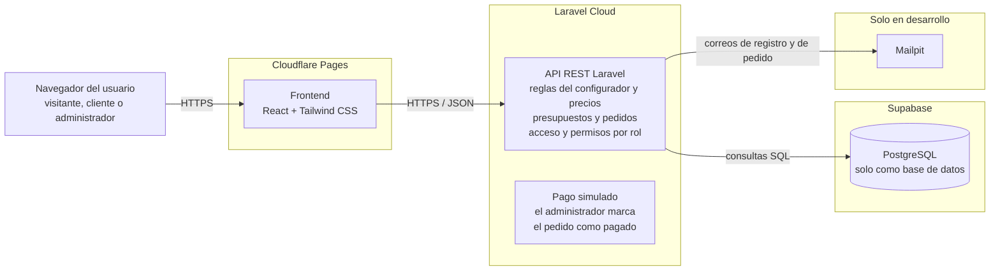
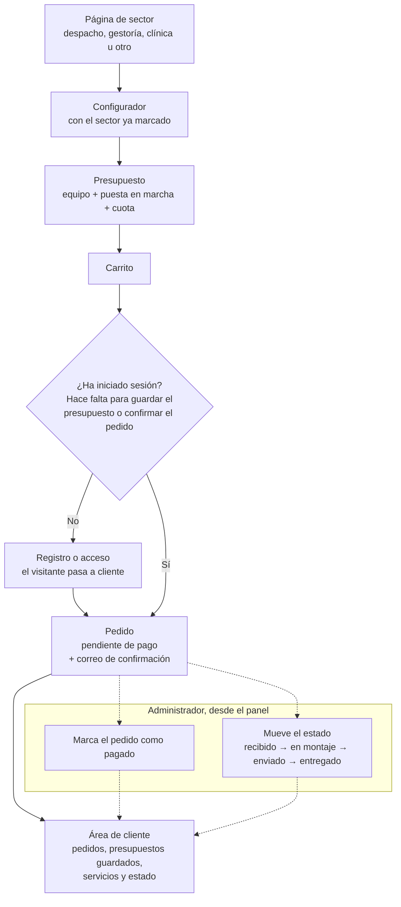
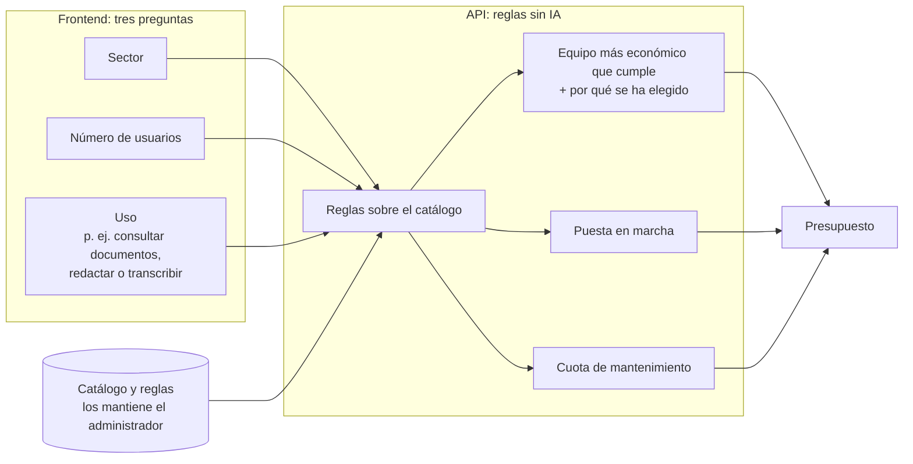

## 1. Arquitectura y flujos funcionales

Cómo funciona la plataforma web de AIComp, en tres diagramas: qué piezas tiene, qué camino sigue el cliente y cómo decide el configurador. Cuadra con los módulos (`docs/sprint-2/01-modules.md`) y los recursos materiales (`docs/sprint-2/03-material-resources.md`) del Sprint 2.

### 1.1 Arquitectura

El usuario solo habla con el frontend, que pinta las pantallas y no decide nada: todo lo pregunta a la API en HTTPS/JSON. La API concentra la lógica (las reglas del configurador, los precios, los presupuestos, los pedidos y el acceso por rol), así que el resultado no se puede manipular desde el navegador. Supabase se usa solo como base de datos PostgreSQL; el acceso lo gestiona Laravel. No hay pasarela de pago ni correo real: el pago se simula y los correos se recogen en Mailpit durante el desarrollo.

### 1.2 Camino del cliente

El visitante entra por la página de su sector, responde al configurador y ve su presupuesto sin registrarse. Para guardar ese presupuesto o confirmar el pedido tiene que registrarse o iniciar sesión, y desde ese momento es cliente. El pedido nace pendiente de pago y el cliente recibe un correo de confirmación. El administrador, desde el panel, lo marca como pagado cuando llega la transferencia y mueve su estado (recibido, en montaje, enviado, entregado). El cliente sigue todo desde su área.

### 1.3 Configurador

El configurador solo pide tres datos: sector, número de usuarios y uso. La API aplica reglas deterministas sobre el catálogo, sin IA, y devuelve el equipo más económico que cumple, con una explicación corta de por qué se ha elegido. A ese equipo le suma la puesta en marcha y la cuota mensual de mantenimiento, y los tres juntos forman el presupuesto. Como el catálogo y las reglas están en la base de datos, el administrador puede ajustarlos sin tocar código.

---

Diagramas de detalle (base de datos, API) en la fase de desarrollo.
