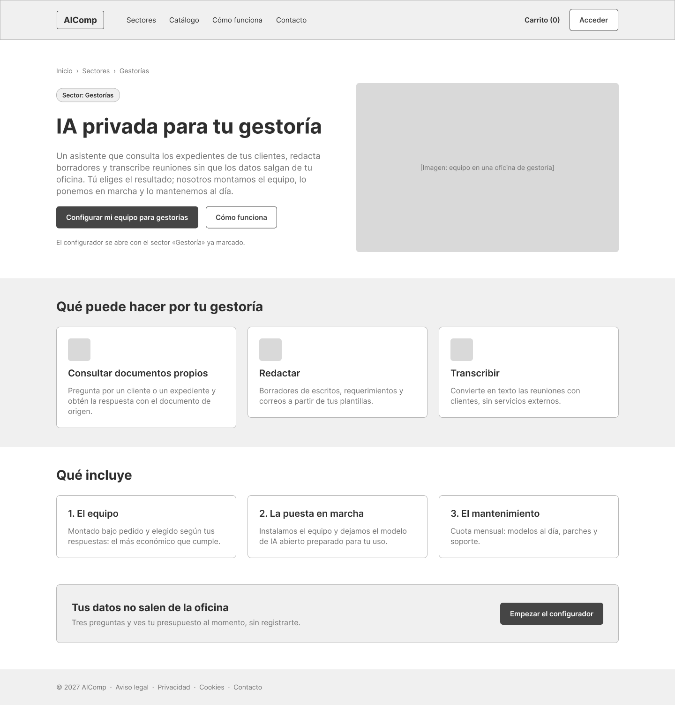
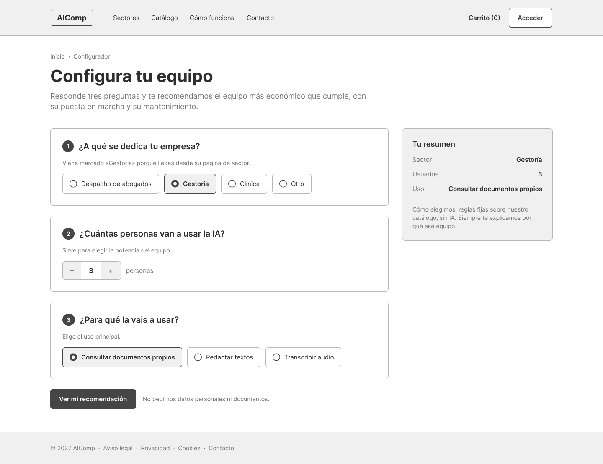
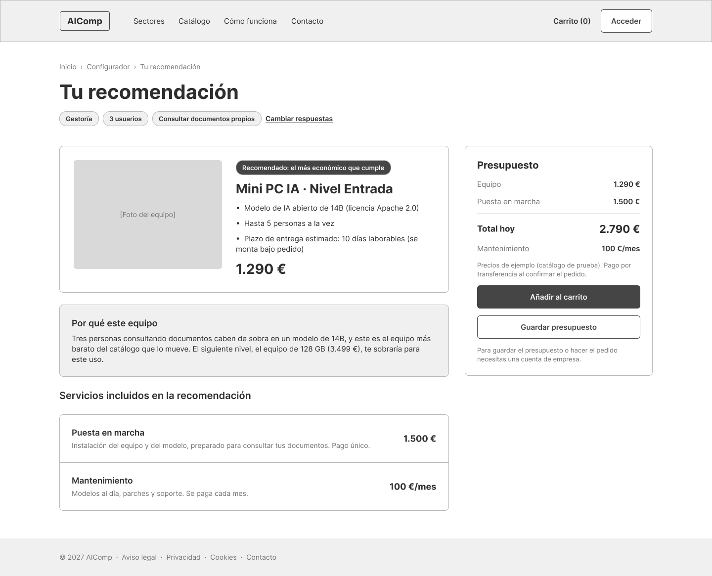
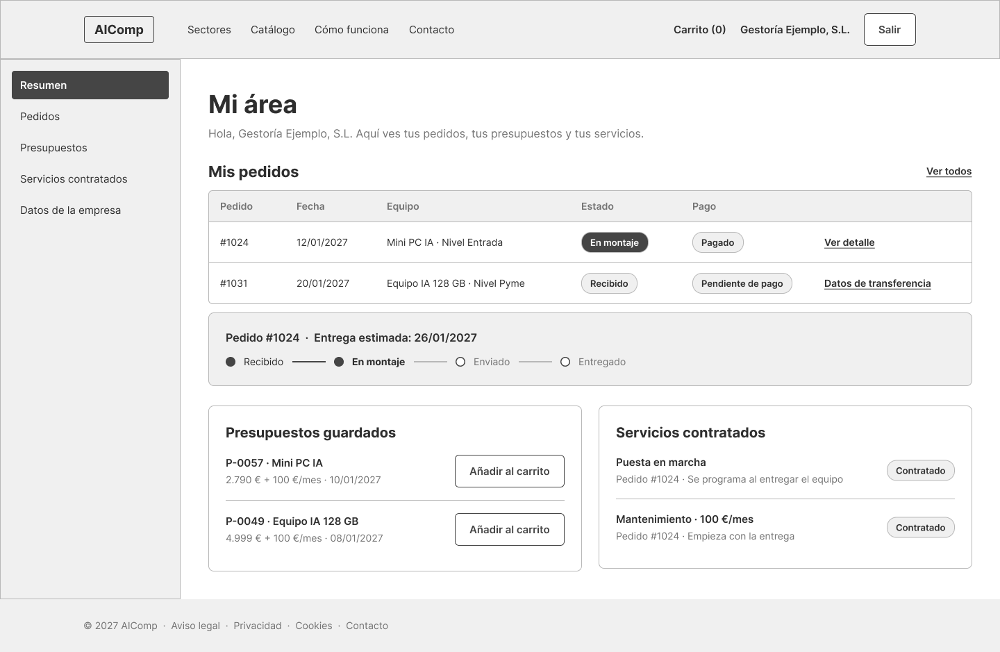
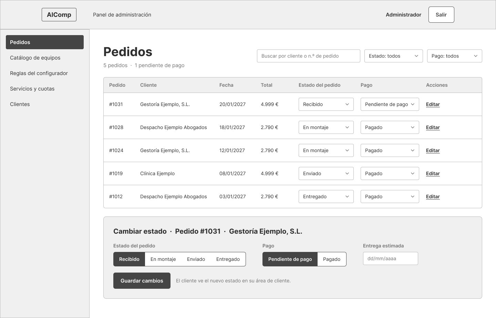

## 2. Wireframes

Wireframes de baja fidelidad de las cinco pantallas clave del MVP, en escritorio (1440 px): grises, cajas y textos reales, sin colores ni imágenes finales. Siguen el camino del cliente definido en el [bloque de módulos del Sprint 2](../sprint-2/01-modules.md): **página de sector → configurador → presupuesto → carrito → pedido → área de cliente**, con el panel de administración detrás.

**Archivo de Figma:** [AIComp – Wireframes](https://www.figma.com/design/oAk9bo7HjgHIskcGZ9DAah) (acceso de lectura para cualquiera con el enlace).

Los precios que aparecen son **datos de ejemplo** del catálogo de prueba: el equipo, dentro del rango de los mini PC de `pitch.md` (apartado 5.1); la puesta en marcha (1.500 €) y la cuota de mantenimiento (100 €/mes), estimación propia tomada de la [viabilidad del Sprint 1](../sprint-1/04-feasibility.md).

### 2.1 Página de sector

**Módulo:** Páginas públicas y contenido por sector (1).
El visitante ve qué ofrece AIComp a su sector (en el ejemplo, gestorías): qué puede hacer la IA con sus documentos y qué incluye la solución (equipo, puesta en marcha y mantenimiento).
Puede leer más o pulsar «Configurar mi equipo para gestorías», que abre el configurador con el sector ya marcado.

### 2.2 Configurador

**Módulo:** Configurador por sector y caso de uso (3).
Las tres preguntas están a la vista a la vez: sector (viene marcado desde la página de sector), número de usuarios y uso principal. A la derecha, un resumen de las respuestas y cómo se elige: reglas fijas sobre el catálogo, sin IA.
Con «Ver mi recomendación» pasa al resultado. No hace falta registrarse ni se piden datos personales.

### 2.3 Resultado y presupuesto

**Módulos:** Configurador (3), Catálogo de equipos (2), Servicios y cuota de mantenimiento (6) y Carrito, presupuesto y pedido (5).
El usuario ve el equipo recomendado (el más económico que cumple), por qué se ha elegido frente al nivel siguiente, la puesta en marcha y la cuota mensual, con el presupuesto total a la derecha.
Puede cambiar las respuestas, «Guardar presupuesto» o «Añadir al carrito». Para guardar o pedir necesita una cuenta de empresa; el pago es por transferencia (simulado).

### 2.4 Área de cliente

**Módulo:** Área de cliente (7).
El cliente ve sus pedidos con el estado y el pago de cada uno, el seguimiento del pedido en curso con la entrega estimada, sus presupuestos guardados y sus servicios contratados.
Desde aquí puede ver el detalle de un pedido, consultar los datos de la transferencia o pasar un presupuesto guardado al carrito.

### 2.5 Panel de administración: pedidos

**Módulos:** Panel de administración (8), con Pago (9) y Logística y plazos (11) simulados.
El administrador ve todos los pedidos con su estado (recibido, en montaje, enviado, entregado) y su pago (pendiente o pagado), y puede filtrarlos.
Cambia ambos desde la propia tabla o desde el bloque «Cambiar estado», donde también fija la entrega estimada; al guardar, el cliente ve el nuevo estado en su área.

Diseño visual de alta fidelidad en la fase de desarrollo.
