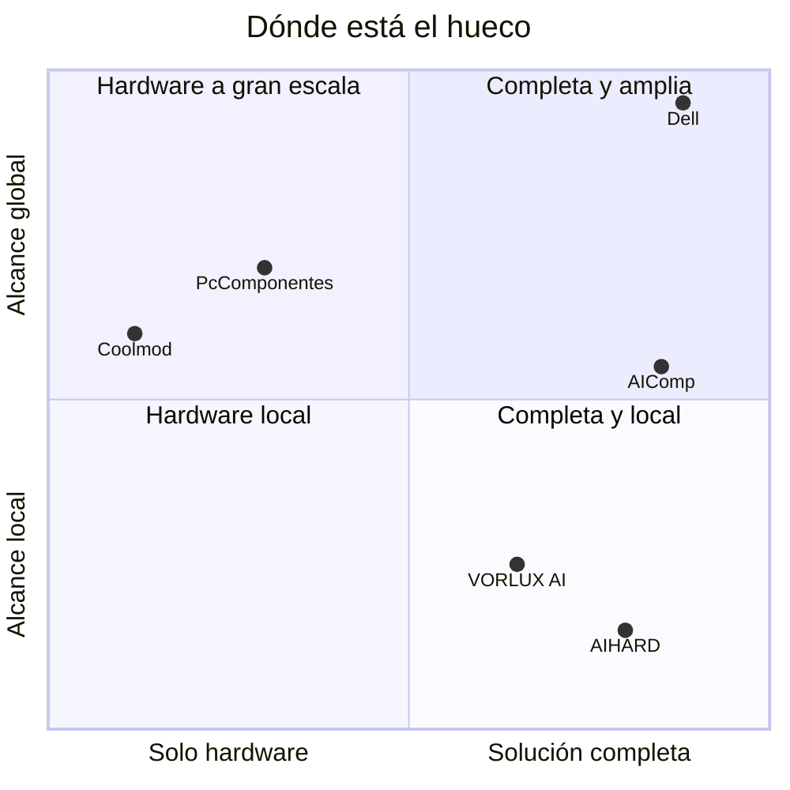
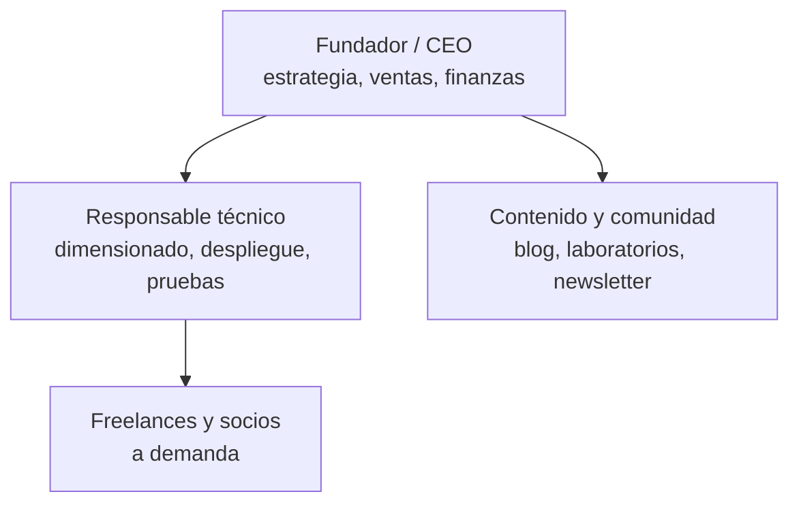
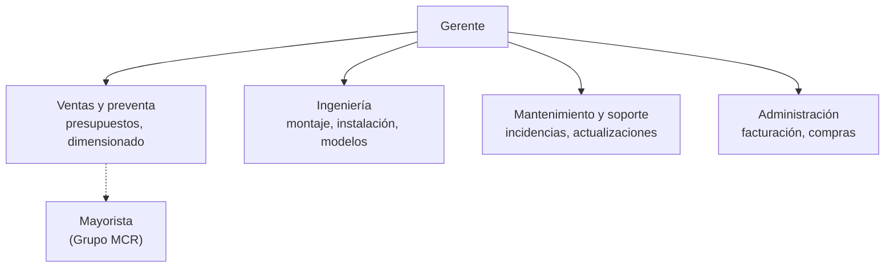
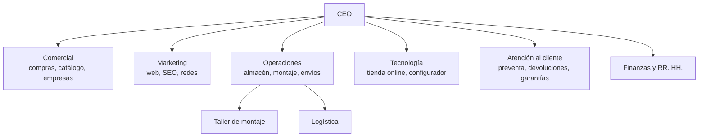
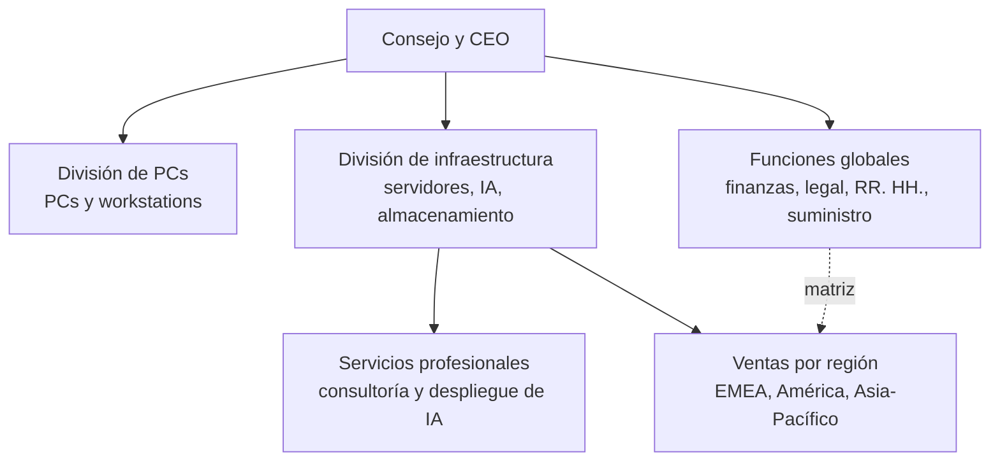
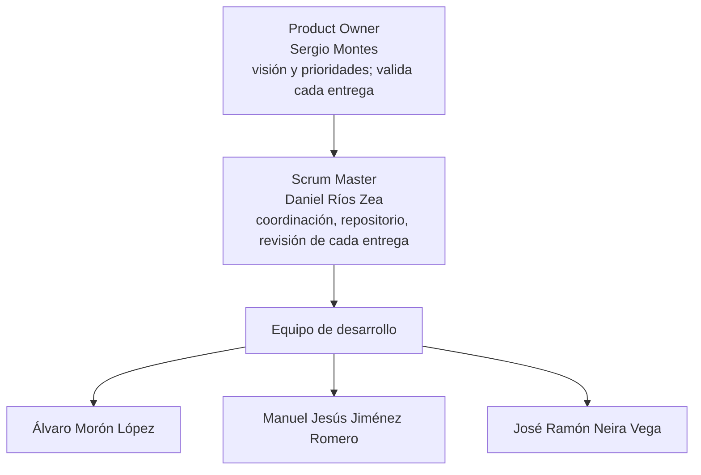

# AIComp

**La IA de tu empresa, montada a medida y sin salir de tu oficina.**

Pitch a inversores · Parte 1: análisis inicial del sector
Equipo DAMN (Dani, Álvaro, Manuel y Neira) · Proyecto Intermodular 2º DAW · ILERNA Sevilla · Octubre de 2026

AIComp vende ordenadores para ejecutar inteligencia artificial **dentro de la propia empresa**. Funciona como una tienda de componentes: el cliente elige su equipo online según lo que necesita, nosotros lo montamos y le llega con modelos de IA ya instalados y adaptados a sus documentos. Encima del equipo ofrecemos instalación, personalización y mantenimiento.

---

## Índice

1. [Introducción al sector](#1-introducción-al-sector)
2. [Empresas analizadas](#2-empresas-analizadas)
3. [Organigramas](#3-organigramas)
4. [Departamentos y funciones](#4-departamentos-y-funciones)
5. [Necesidades y volumen de negocio](#5-necesidades-y-volumen-de-negocio)
6. [Tendencias y oportunidades](#6-tendencias-y-oportunidades)
7. [Conclusiones iniciales](#7-conclusiones-iniciales)
8. [Organigrama de AIComp](#8-organigrama-de-aicomp)
9. [Fuentes](#9-fuentes)

---

## 1. Introducción al sector

El sector vende **ordenadores preparados para ejecutar modelos de IA en las instalaciones del cliente** (IA «local» u *on-premise*), en lugar de enviar los datos a un servicio en la nube. Une dos negocios que ya existían y les añade una capa nueva:

| Negocio | Qué hace | Ejemplos |
| --- | --- | --- |
| Tienda online de componentes | El cliente elige piezas en la web y la tienda monta y envía el equipo | PcComponentes, Coolmod |
| Integración de sistemas | Un proveedor instala, configura y mantiene la infraestructura en la empresa | AIHARD, Dell |
| **Lo nuevo: la capa de modelos** | El equipo llega con modelos abiertos instalados y adaptados a los documentos de la empresa | Llama, Qwen, Gemma, Mistral |

### Por qué ahora

- **La adopción crece rápido.** El 21,1 % de las empresas españolas con 10 o más empleados usó IA en el primer trimestre de 2025, 8,7 puntos más que un año antes (INE).
- **Las empresas quieren sus datos en casa.** El 91 % de los responsables de TI elegiría infraestructura propia, nube privada o un modelo híbrido para usar IA con datos sensibles. Es una encuesta de febrero de 2026 a 203 empresas, encargada por Cloudian, un fabricante de almacenamiento local.
- **Los grandes se mueven.** El 13 de octubre de 2026, el CEO de PcComponentes confirmó que venderá a empresas «desde workstations hasta servidores para ejecutar modelos en local» (Xataka).

---

## 2. Empresas analizadas

Hemos analizado cinco empresas reales que cubren todos los tamaños y todas las formas de llegar al cliente:

- una startup de consultoría;
- un pequeño integrador, con un modelo parecido al de una agencia;
- una tienda online mediana;
- una tienda online grande;
- una multinacional con su propio brazo de consultoría.

Los tamaños siguen la definición de la UE:

| Tamaño | Empleados |
| --- | --- |
| Micro | Menos de 10 |
| Pequeña | Menos de 50 |
| Mediana | Menos de 250 |
| Grande | 250 o más |

| Empresa | Tamaño | Sede | Qué vende | Clientes | Datos de tamaño |
| --- | --- | --- | --- | --- | --- |
| [VORLUX AI](https://vorluxai.com/) | Micro (startup) | Valencia | Asesoría, dimensionado y despliegue de IA local; recomendación de equipos; herramientas para desarrolladores; plantillas de AI Act y RGPD; formación | Desarrolladores, pymes europeas y sector público preocupados por la soberanía de sus datos | La gestiona J4SGON S.L.; plantilla no pública |
| [AIHARD](https://www.aihard.es/) | Micro o pequeña (integrador) | Castelldefels (Barcelona) | Mini PC de IA, workstations, servidores para pymes, racks y CPD; instalación de modelos y agentes; mantenimiento; formación | Autónomos, despachos, pymes y naves industriales (cámaras con IA) | Marca de Vanguard LB Consulting S.L.U.; plantilla no pública |
| [Coolmod](https://valenciaplaza.com/valenciaplaza/empresas1/coolmod-los-lideres-en-montaje-de-ordenadores-a-la-carta-que-deslumbran-a-nvidia-desde-castellon) | Mediana | Almassora (Castellón) | Tienda online de hardware de gama alta y PCs a medida (90–100 al día) | Gamers, profesionales del diseño, los datos y la IA, universidades, centros de investigación | 65 empleados (unos 85 en picos); 38–40 M€ previstos en 2025 |
| [PcComponentes](https://www.xataka.com/robotica-e-ia/uno-mayores-distribuidores-hardware-espana-ha-tenido-idea-para-seguir-creciendo-convertirse-dell) | Grande (nacional) | Alhama de Murcia | E-commerce con configurador de PCs y marketplace; desde octubre de 2026, equipos y servidores de IA local para empresas | Particulares y empresas de España, Francia, Alemania, Italia y Portugal | 825 M€ de ventas en 2025 (+13 %); más de 550 empleados (2020, último dato público) |
| [Dell Technologies](https://www.tikr.com/blog/dell-closes-fy2026-with-record-113b-revenue-why-analysts-see-a-171-price) | Grande (multinacional) | Round Rock (Texas, EE. UU.) | PCs, workstations, servidores de IA y servicios profesionales | Grandes empresas, administraciones y proveedores de nube | 113.000 M$ de ingresos en el año fiscal 2026; 25.200 M$ en servidores de IA; unos 97.000 empleados |

### Ficha de cada empresa

**VORLUX AI: la startup de consultoría.**
- **Qué vende:** sobre todo conocimiento, no equipos. Recomienda hardware según la tarea, publica sus propias pruebas de rendimiento y ofrece dimensionado, despliegue en la red del cliente, plantillas de cumplimiento y formación. Por ejemplo, mide Gemma 4 26B a 60,7 tokens por segundo en una DGX Spark.
- **Precios de equipos que publica:**
  - Beelink SER8: unos 550 €, para modelos de 7–8B.
  - Mac Mini M4 Pro de 48 GB: unos 1.840 €, para 32B.
  - Jetson AGX Thor de 128 GB: unos 3.499 €, para 70B.
- **Servicios:** no publica precios. El primer contacto es una llamada gratuita de 15 minutos.

**AIHARD: el pequeño integrador.**
- **Qué vende:** es lo más parecido a lo que queremos ser. Vende el equipo **y además** instala modelos y agentes (Ollama, RAG, MCP). Después los mantiene: vigilancia, actualización de modelos y reindexado de documentos.
- **Precios:** su producto de entrada es un mini PC de IA para 1–3 personas, desde **1.167,99 € con IVA**. Los servidores para pymes, con dos tarjetas gráficas de 16 GB, se presupuestan a medida.
- **Alcance:** solo va a domicilio en la zona de Barcelona; en el resto trabaja en remoto.

**Coolmod: la tienda especializada mediana.**
- **Quién es:** nació en 2002 y monta PCs a medida. Según Nvidia, es una de las tres empresas que más tarjetas gráficas venden en España.
- **Clientes:** unos 500.000, con un ticket medio cercano a 900 €.
- **Servicio:** **no** ofrece mantenimiento; deriva a instaladores locales.
- **Objetivos:** 100 M€ de facturación en 2028 y expansión a Francia, Alemania e Italia.

**PcComponentes: la gran tienda nacional.**
- **Quién es:** nació en 2005 con 3.000 € de capital y monta PCs a medida desde su primer año. Hoy tiene un centro logístico de 40.000 m².
- **Novedad:** en octubre de 2026 anunció sistemas de IA local para empresas, con asesoramiento sobre qué equipo encaja en cada caso.
- **Para nosotros:** es el competidor más fuerte en España.

**Dell Technologies: la multinacional.**
- **Quién es:** empezó en 1984 vendiendo PCs y hoy es uno de los grandes proveedores de servidores de IA.
- **Cifras de IA en el año fiscal 2026:** cerró 64.100 M$ en pedidos de IA y terminó con 43.000 M$ pendientes de entregar.
- **Cómo trabaja:** combina fabricación, ventas globales y un brazo de consultoría que diseña y despliega infraestructura de IA para grandes clientes.

### Mapa del sector

*Posición cualitativa, de elaboración propia.*

- **Las tiendas llegan a toda España, pero venden sobre todo hardware.** PcComponentes empieza a moverse hacia la derecha.
- **Quienes dan la solución completa son locales o atienden a grandes clientes.**
- **El hueco de AIComp:** la solución completa, vendida online a las pymes de toda España.

---

## 3. Organigramas

Las cinco empresas muestran cuatro modelos de organización. Al crecer, una empresa pasa de personas que lo hacen todo a departamentos; después, a divisiones de negocio y, al final, a una matriz.

### 3.1 Startup (tipo VORLUX AI): estructura plana

Dos o tres personas cubren todas las funciones. El fundador vende, decide y a menudo ejecuta el proyecto. Las decisiones son inmediatas, pero la empresa depende de muy pocas personas y no puede llevar muchos proyectos a la vez.

### 3.2 Pequeño integrador (modelo «agencia», tipo AIHARD): estructura por servicio

Se organiza según **lo que entrega al cliente**: vender, montar, instalar y mantener, como una agencia de servicios. Cada proyecto pasa por todas las áreas y el gerente revisa cada presupuesto. Los socios externos, como un mayorista u otras consultoras, sustituyen a los departamentos que no puede permitirse.

### 3.3 E-commerce mediano y grande (tipo Coolmod y PcComponentes): estructura funcional

Hay un departamento por **función**, cada uno con su responsable. La especialización es alta y los procesos están estandarizados: Coolmod monta 90–100 PCs al día. PcComponentes añade capas encima: equipos por país para sus cinco mercados, un marketplace y una oficina tecnológica en Granada. El reto principal pasa a ser coordinar los departamentos.

### 3.4 Multinacional (tipo Dell Technologies): estructura divisional y matricial

Se divide por **línea de negocio** (PCs frente a infraestructura) y por **región**. Un comercial en España depende a la vez de su responsable regional y de la división de producto: eso es la matriz. Puede hacer proyectos en cualquier país, pero las decisiones son lentas y un cliente pequeño no es prioritario.

### 3.5 Comparación entre tipos de empresa

| Aspecto | Startup | Pequeño integrador (agencia) | E-commerce mediano o grande | Multinacional (consultora) |
| --- | --- | --- | --- | --- |
| Modelo | Plana | Por servicio | Funcional | Divisional y matricial |
| Niveles jerárquicos | 1–2 | 2 | 3–4 | 5 o más |
| Quién decide | El fundador, al momento | El gerente, en cada proyecto | Jefes de departamento, por procesos | Comités por división y región |
| Especialización | Baja: todos hacen de todo | Media | Alta | Muy alta |
| Rapidez con un cliente nuevo | Muy alta | Alta | Media: catálogo estándar | Baja si el cliente es pequeño |
| Riesgo principal | Depende de 2–3 personas | El gerente, cuello de botella | Departamentos aislados entre sí | Burocracia y coste alto |
| Cliente típico | Pioneros | Pymes de la zona | Particulares y pymes de todo el país | Grandes empresas y administraciones |

---

## 4. Departamentos y funciones

Estos son los departamentos principales del sector. Para cada uno se indican sus funciones, cómo contribuye al negocio y en qué tipo de empresa aparece.

### Departamentos que mueven el negocio

| Departamento | Funciones | Cómo contribuye al negocio | Dónde aparece |
| --- | --- | --- | --- |
| **Dirección** | Estrategia, inversión, alianzas con fabricantes (Nvidia, AMD), política de precios | Decide a qué clientes ir y asegura stock y margen. Los acuerdos de Coolmod con Nvidia le dan un stock que otros no tienen | Todas |
| **Ventas y preventa** | Detectar la necesidad, dimensionar el equipo según el uso, presupuestar, cerrar la venta | Convierte una necesidad vaga («quiero IA para mis documentos») en un pedido concreto. En este sector, el asesoramiento previo es parte del producto | Todas; equipo propio a partir de empresa mediana |
| **Compras y suministro** | Comprar GPU, memoria y componentes; negociar con mayoristas; gestionar el stock | Con los precios de GPU y memoria disparados, comprar bien decide el margen y el plazo de entrega | Medianas y grandes |
| **Montaje y calidad** | Montar el equipo, pruebas de estrés, instalar sistema y drivers, control de calidad | Garantiza que el equipo funciona al llegar. Devolver un equipo de 5.000–20.000 € sale muy caro | Todas (en una startup, subcontratado) |
| **Logística** | Almacén, embalaje, envíos y devoluciones | Entrega rápida y segura de equipos frágiles y caros. PcComponentes construyó un centro de 40.000 m² para esto | Medianas y grandes |
| **Ingeniería de IA** | Instalar y ajustar modelos, montar RAG sobre los documentos, agentes, ajuste fino, pruebas de rendimiento | Es lo que diferencia a un integrador de una tienda: el cliente compra una solución que funciona, no una caja | Startups e integradores; nuevo en las grandes tiendas |

### Departamentos que lo sostienen

| Departamento | Funciones | Cómo contribuye al negocio | Dónde aparece |
| --- | --- | --- | --- |
| **Soporte y mantenimiento** | Incidencias, actualizar modelos, parches de seguridad, vigilancia, garantía | Genera ingresos recurrentes y relaciones largas con el cliente. Coolmod no lo ofrece: es un hueco | Integradores y multinacionales |
| **Tecnología web** | Tienda online, configurador de producto, sistemas internos (ERP, CRM) | En un negocio online, el configurador es el escaparate y el motor de ventas | Medianas y grandes |
| **Marketing** | Marca, SEO, contenidos, redes sociales, ferias, newsletter | Explica un producto que muchas empresas aún no conocen. VORLUX y AIHARD captan clientes con blogs y formación gratuita | Todas |
| **Administración, finanzas y legal** | Facturación, contabilidad, financiación, contratos, cumplimiento del RGPD y del AI Act | Sostiene la caja con un stock muy caro y ayuda al cliente con sus obligaciones legales | Todas; subcontratada en las pequeñas |
| **Recursos humanos** | Selección, formación, prácticas, cultura | El talento técnico escasea. Coolmod acoge 12–14 becarios al año, y el 60–70 % de su plantilla empezó como estudiante | Medianas y grandes |

**Quién cubre cada función según el tamaño:**
- **Startup:** dos o tres personas lo hacen todo.
- **Empresa mediana:** cada función es un departamento con su responsable.
- **Multinacional:** cada función es una división entera, presente en varios países.

---

## 5. Necesidades y volumen de negocio

### 5.1 Quiénes son los clientes

España tenía **3.310.824 empresas activas** a 1 de enero de 2025 (INE, DIRCE):

| Empleados | Empresas |
| --- | --- |
| 1–9 | 1.348.909 |
| 10–19 | 85.467 |
| 20 o más | 76.005 |

Cada tipo de cliente tiene una necesidad distinta, y a cada una le corresponde un equipo y un precio:

| Cliente | Necesidad | Solución | Precio del equipo |
| --- | --- | --- | --- |
| **Autónomos y micro** (1–3 usuarios): despachos, gestorías, clínicas | Asistente privado para redactar, resumir y buscar sin subir datos de clientes | Mini PC con un modelo de 7–32B | **550–1.840 €** (referencias de VORLUX AI); el mini PC de AIHARD, desde **1.167,99 €** con IVA |
| **Pequeñas empresas** (5–20 usuarios) | Asistente común sobre los documentos de la empresa, transcripción, borradores para atención al cliente | Equipo de 128 GB (clase DGX Spark o Jetson AGX Thor) con un modelo de 70B | **3.499 €** (Jetson AGX Thor) a **5.038–8.096 €** sin IVA (modelos DGX Spark) |
| **Medianas** (20–100 usuarios) | Varios departamentos a la vez, agentes conectados al ERP y al CRM, modelos adaptados al negocio | Workstation con 1–2 tarjetas RTX PRO 6000 de 96 GB | **≈ 22.000–45.000 €** (estimación propia: 17.003 € por tarjeta en octubre de 2026, más el resto del equipo) |
| **Grandes empresas y sector público** | Muchos usuarios a la vez, entrenamiento y ajuste fino, alta disponibilidad | Servidores multi-GPU instalados en su CPD | **80.000 € o más** por servidor (estimación propia); proyectos de tipo Dell, de millones |

Sobre el equipo se suman los servicios, que son **ingresos recurrentes**:
- **Instalación y puesta en marcha** de los modelos.
- **Personalización:** RAG sobre los documentos del cliente o ajuste fino.
- **Mantenimiento:** suscripción con actualizaciones, parches y soporte.

AIHARD y VORLUX presupuestan estos servicios a medida. Los precios de AIComp se fijarán en una tarea posterior.

### 5.2 Ejemplos concretos de proyecto

1. **Despacho de tres abogados.**
   - **Necesidad:** resumir expedientes sin romper el secreto profesional.
   - **Solución:** mini PC con un modelo de 14–32B y RAG sobre sus expedientes.
   - **Coste:** unos 1.200–1.900 € de equipo, más la instalación.
2. **Ingeniería con 50 empleados.** Es el caso que cita la propia PcComponentes: un RAG privado para 50 empleados.

   | Opción | Coste | Datos |
   | --- | --- | --- |
   | Nube: Microsoft 365 Copilot Business (18 $ por usuario y mes, compromiso anual) | **10.800 $ al año**; 18.000 $ al año con la tarifa Enterprise (30 $) | Salen de la empresa |
   | Local con AIComp: equipo de 128 GB con un modelo de 70B | **5.000–8.000 €**, pago único, más servicios | No salen de la oficina |

   La comparación es orientativa: Copilot se integra con Office, y un modelo local no hace lo mismo. Aun así, el coste está en el mismo orden que un año de suscripción, y los datos se quedan en casa.
3. **Hospital o administración pública.**
   - **Necesidad:** muchos usuarios, datos de salud sensibles y requisitos legales estrictos.
   - **Solución:** servidor multi-GPU en su propio CPD, con contrato de mantenimiento.
   - **Competencia:** aquí compite Dell.

### 5.3 Tamaño de la oportunidad

- **El sector ya mueve mucho dinero.**

  | Empresa | Cifra |
  | --- | --- |
  | PcComponentes | 825 M€ de ventas en 2025 |
  | Coolmod | 38–40 M€ previstos en 2025 |
  | Dell | 25.200 M$ en servidores de IA en el año fiscal 2026 |

  PcComponentes, además, ha visto un «aumento significativo» de empresas que compran hardware para proyectos de IA local.
- **La adopción todavía es baja.** Solo una de cada cinco empresas con 10 o más empleados usaba IA a principios de 2025. La mayor parte del mercado aún no ha comprado.
- **Escenario ilustrativo** (elaboración propia, no es una previsión):

  | Concepto | Valor |
  | --- | --- |
  | Empresas con 10 o más empleados | 161.472 |
  | Supuesto: compran un equipo al año | 1 % |
  | Precio medio del equipo de departamento | 6.000 € |
  | **Mercado anual solo en equipos, sin servicios** | **≈ 9,7 M€** |
  | Si AIComp captase el 2 % de ese escenario | ≈ 190.000 € al año |

---

## 6. Tendencias y oportunidades

| Tendencia | Qué está pasando | Para AIComp |
| --- | --- | --- |
| **Soberanía de los datos** | El 91 % de los responsables de TI prefiere infraestructura propia, privada o híbrida para IA con datos sensibles, y el 58 % dice que la ubicación de los datos ha retrasado o recortado proyectos de IA (Cloudian, 2026) | **Oportunidad:** es nuestro mensaje central; el cliente guarda sus datos en su oficina |
| **Regulación: AI Act y RGPD** | Las obligaciones de transparencia del AI Act aplican desde el 2 de agosto de 2026. Las de alto riesgo se han aplazado al 2 de diciembre de 2027 (anexo III) y al 2 de agosto de 2028 (anexo I). La alfabetización en IA es obligatoria desde febrero de 2025 | **Oportunidad:** vender ayuda con el cumplimiento y formación junto al equipo. La incertidumbre frena a algunos compradores |
| **Mejores modelos abiertos en equipos más pequeños** | Modelos de 70B ya funcionan en equipos de sobremesa de 128 GB de memoria unificada (DGX Spark, Ryzen AI Max+ 395, Jetson Thor) | **Oportunidad:** un equipo de departamento cuesta miles de euros, no decenas de miles |
| **GPU y memoria más caras** | La memoria y el almacenamiento subieron un 40–70 % en 2025 (Omdia). La RTX 5090 supera de media los 6.200 € en España (agosto de 2026). La RTX PRO 6000 pasó de 7.628 € a 17.003 € en 12 meses | **Riesgo:** márgenes y stock. **Oportunidad:** el cliente necesita asesoramiento para no comprar de más |
| **Llegan los grandes** | PcComponentes anunció IA local para empresas en octubre de 2026 | **Riesgo:** competencia en precio. **Validación:** el mercado existe. Nuestro espacio: servicio personalizado, modelos adaptados y mantenimiento |
| **Falta de conocimiento** | Es el primer motivo que dan las empresas europeas medianas y grandes para no usar IA, por delante de la privacidad y la inseguridad jurídica (Eurostat 2025, vía Euronews) | **Oportunidad:** entregar la solución lista para usar, con formación |

---

## 7. Conclusiones iniciales

1. **Hay un hueco entre la tienda y la consultoría.**
   - Las tiendas (Coolmod, PcComponentes) venden muy buen hardware, pero poco servicio.
   - Los integradores (AIHARD, VORLUX) dan servicio, pero son locales o pequeños.
   - Una empresa que una **configurador online por caso de uso**, **modelos preinstalados y adaptados** y **mantenimiento** tiene sitio para crecer.
2. **Nuestro cliente es la pyme.**
   - Los autónomos y las empresas de 3 a 100 empleados necesitan privacidad, no pueden contratar ingenieros de IA y no son prioridad para las multinacionales.
   - En España hay más de 1,5 millones de empresas con asalariados.
3. **Vender soluciones, no componentes.**
   - Con precios de GPU tan volátiles, el margen del hardware solo es frágil.
   - Los ingresos recurrentes (instalación, personalización y mantenimiento) dan estabilidad.
4. **Empezar plana y crecer por funciones.**
   - Arrancamos como startup.
   - Al crecer, pasaremos a una estructura funcional: preventa, ingeniería, operaciones y soporte.
   - Lo haremos sin caer en los departamentos aislados de las grandes.
5. **Siguiente paso:** definir el MVP de la web (el configurador por caso de uso), el catálogo de equipos por nivel y los precios de los servicios.

---

## 8. Organigrama de AIComp

AIComp mantiene la misma estructura que el equipo del proyecto:

Las áreas técnicas (frontend, backend, base de datos, integraciones, diseño y despliegue) se asignan en cada Sprint Planning, y todos los miembros pasan por todas ellas a lo largo del proyecto. Más detalle en [docs/team/README.md](docs/team/README.md).

---

## 9. Fuentes

Todas consultadas en octubre de 2026.

**Empresas**
- [VORLUX AI, web](https://vorluxai.com/)
- [AIHARD, web](https://www.aihard.es/) y [servicios](https://www.aihard.es/es/servicios)
- [Valencia Plaza: Coolmod, los líderes en montaje de ordenadores a la carta (24/11/2025)](https://valenciaplaza.com/valenciaplaza/empresas1/coolmod-los-lideres-en-montaje-de-ordenadores-a-la-carta-que-deslumbran-a-nvidia-desde-castellon)
- [Xataka: PcComponentes y la IA local (13/10/2026)](https://www.xataka.com/robotica-e-ia/uno-mayores-distribuidores-hardware-espana-ha-tenido-idea-para-seguir-creciendo-convertirse-dell)
- [Murcia Plaza: PcComponentes factura 730 M€ en 2024 (10/10/2025)](https://murciaplaza.com/murciaplaza/empresas-murcia/pccomponentes-espera-elevar-sus-ventas-un-15-este-2025-tras-alcanzar-una-facturacion-de-730-millones)
- [PcComponentes: «Nuestra historia»](https://www.pccomponentes.com/quienes-somos-historia)
- [Hispanopedia: PcComponentes](https://es.hispanopedia.com/wiki/PcComponentes)
- [TIKR: Dell cierra el año fiscal 2026 con 113.000 M$ (01/04/2026)](https://www.tikr.com/blog/dell-closes-fy2026-with-record-113b-revenue-why-analysts-see-a-171-price)
- [Business Today: plantilla de Dell en el año fiscal 2026 (17/03/2026)](https://www.businesstoday.in/amp/technology/story/dell-reduces-workforce-by-11000-in-fiscal-2026-as-it-restructure-operations-520905-2026-03-17)

**Mercado**
- [INE: Directorio Central de Empresas 2025 (11/12/2025)](https://ine.es/dyngs/Prensa/DIRCE2025.htm)
- [Bolsamanía: el 21,1 % de las empresas usó IA en el primer trimestre de 2025, según el INE (22/10/2025)](https://www.bolsamania.com/noticias/empresas/economia--el-211-de-empresas-en-espana-de-10-o-mas-empleados-uso-la-ia-en-el-primer-trimestre-del-ano-segun-el-ine--21080387.html)
- [Cloudian: encuesta sobre la vuelta de la IA a infraestructura propia (03/03/2026)](https://cloudian.com/press/enterprise-repatriating-ai-workloads/)
- [Euronews: por qué las empresas europeas no usan IA (25/05/2026)](https://es.euronews.com/next/2026/05/25/por-que-las-empresas-europeas-no-usan-herramientas-de-ia)

**Regulación**
- [Gibson Dunn: acuerdo Omnibus del AI Act (27/05/2026)](https://www.gibsondunn.com/eu-ai-act-omnibus-agreement-postponed-high-risk-deadlines-and-other-key-changes/)

**Precios y hardware**
- [pi3g: precios de NVIDIA DGX Spark en la UE y EE. UU. (octubre de 2026)](https://pi3g.com/nvidia-dgx-spark-price/)
- [GPUPrix: precio de la RTX PRO 6000 Blackwell en España (18/10/2026)](https://gpuprix.com/spain/gpus/rtx-pro-6000-blackwell)
- [Geeknetic: el precio medio de la RTX 5090 supera los 6.200 € en España (31/08/2026)](https://www.geeknetic.es/Noticia/39932/El-precio-medio-de-las-RTX-5090-ya-supera-los-6200-euros-en-Espana.html)
- [The Register: escasez de memoria y subida de precios (12/01/2026)](https://www.theregister.com/2026/01/12/memory_shortages_price_hikes/)
- [eesel: precios de Microsoft 365 Copilot en 2026](https://eesel.ai/blog/copilot-pricing)
